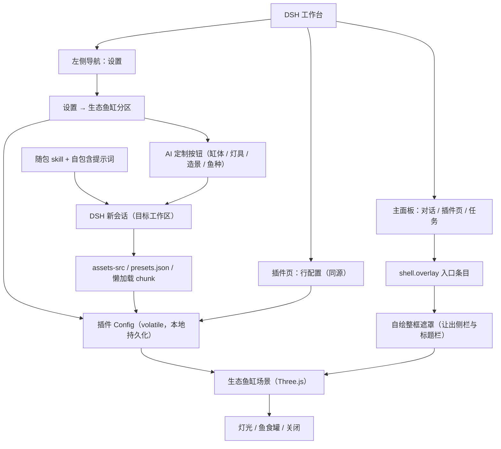
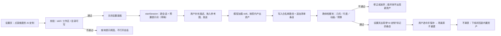
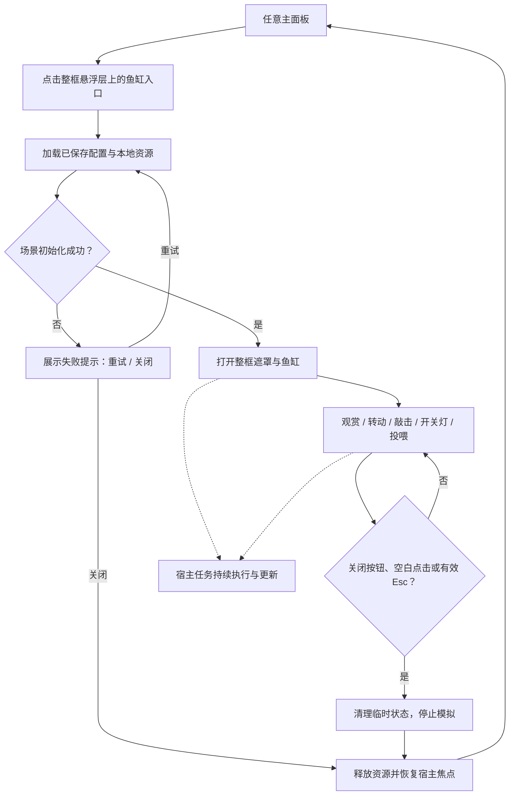
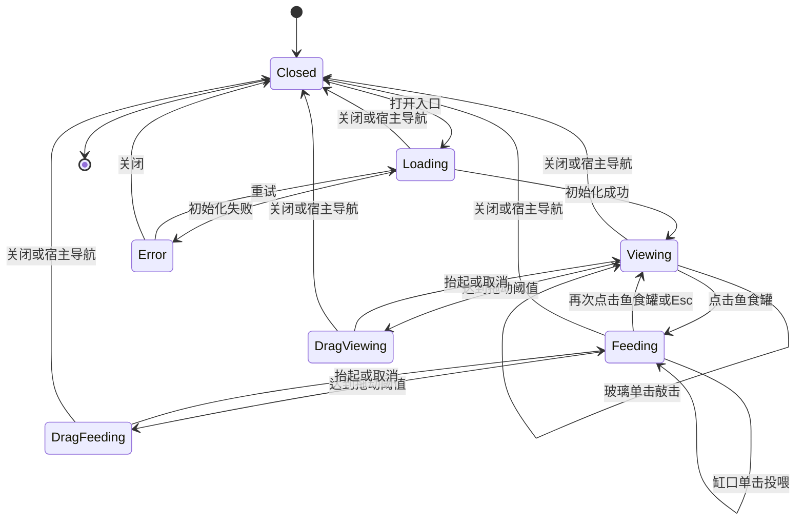
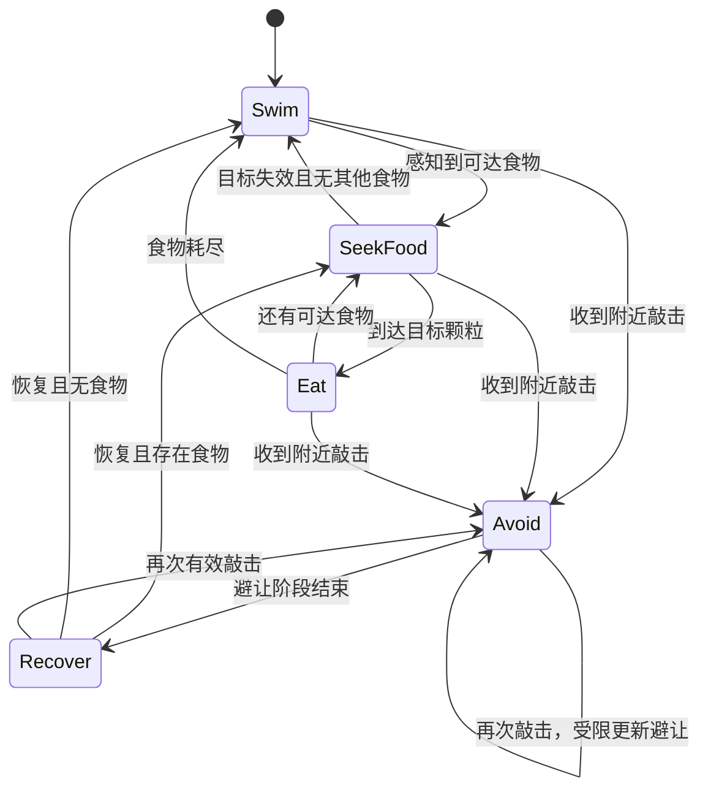
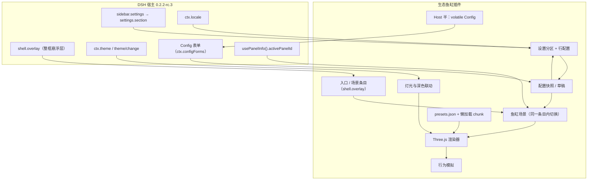
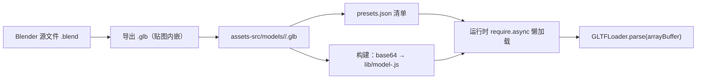
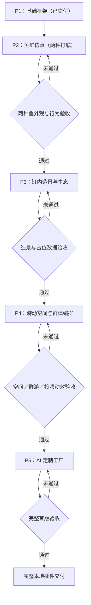
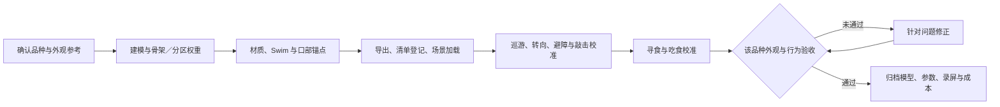

# DSH 生态鱼缸插件需求规格说明书

| 项目 | 内容 |
| --- | --- |
| 产品名称 | DSH 生态鱼缸 |
| 适用宿主 | DSH（DeepSeek harness）办公工作台 |
| 文档版本 | v1.4（内置群游鱼由银鲦替换为红绿灯） |
| 编写日期 | 2026-11-19 |
| 核实基线 | DSH Desktop 0.2.2-rc.3：本机安装的内置文档、相关包源码（含 `ui-workspace`、`ui-session`、`ui-conversation`），以及运行中客户端的 Slot 目录 |
| 文档用途 | 产品设计、插件开发、视觉实现与验收 |
| 需求依据 | 用户提供的“闪念胶囊”口述、DSH 全局悬浮层参考图、用户订正的宿主与素材路线、三阶段实施要求，以及 2026-11-19 “闪念胶囊”提出的 AI 定制构想与阶段重组意见 |
| 当前状态 | v1.4 已撤下银鲦，正式鱼群改为 5 条红绿灯 + 2 条小丑鱼；红绿灯按用户四视图参考完成独立资产、六区虚拟骨骼、四角度/泳姿/缸内验收。P3 造景与既有交互保持可用 |

> 本文将口述转化为可实施的行为规则。用户明确提出的内容标记为“原始要求”；为实现交互闭环补充的内容标记为“补充规则”；选项清单、时间、数量、阈值和性能目标若未由用户指定，均属于“建议默认值”，可在视觉原型和宿主联调后调整。
>
> v1.1 起，凡涉及宿主能力的结论都带核实标记：**已核实**表示该扩展点或服务在 DSH 0.2.2-rc.3 的文档与源码中确实存在，并已在运行中客户端的 Slot 目录里确认；**需实测**表示能力具备但尚未在本 GUI 中跑通验证；**缺口**表示宿主不提供，必须调整设计。核实依据见 [8.5](#85-宿主能力核实结果)。
>
> v1.2 沿用用户订正后的 v1.1 核实记录，本次没有重新验证宿主接口。全文“首版”指全部实施阶段完成后的完整版本，不要求第一阶段就交付全部鱼群、素材选择和设置功能。阶段范围与任务拆分以第 11 节为准。
>
> v1.3 依据本机 DSH Desktop 0.2.2-rc.3 的 `ui-workspace`、`ui-session`、`ui-conversation` 包源码与 `skills` 子系统文档，补充核实了“客户端能否打开指定工作区的新会话并预置提示词”“插件能否随包提供 skill”两项能力（见 8.5）。这两项能力是新增“AI 定制工厂”的前置条件；本次只是把它们写进需求，不代表已经实现。
>
> v1.3 同时重组实施阶段：原 v1.2 的“P2 九种鱼”被取消，改为红绿灯与小丑鱼两种打底；造景独立为 P3，游动空间、群游算法与投喂动效独立为 P4，AI 定制为 P5。第 11 节已按五阶段重写，原 11.3～11.6 的小任务表与九种鱼登记表不再有效；AC-27～AC-31 的“九种”口径已相应改为“两种”，并新增 AC-32～AC-39。P1 的范围与验收口径不变。

## 修订摘要（v1.3 → v1.4）

1. **内置鱼种替换**：银鲦不再入缸，旧 GLB 仅作历史归档；默认群游鱼改为红绿灯 ×5，小丑鱼 ×2 不变。
2. **独立资产与四视图验收**：红绿灯使用用户提供的侧面、正面和俯视参考，保留原始重建源文件；正式 GLB 为 10,000 面、512² baseColor、256² normal，体长 4 cm。
3. **独立动作分区**：`src/neon-tetra.js` 烘焙身体、背鳍、臀鳍、尾鳍、胸鳍、腹鳍六区；节点旋转先烘焙进几何，避免把体厚轴误当背腹轴。
4. **验收已执行**：22/22 测试、构建、冒烟通过；整缸 7 条约 52 FPS、54 draw calls，全部 `in-water`，控制台干净。详见 `docs/P2-红绿灯重制.md`。

## 修订摘要（v1.2 → v1.3）

1. **产品定位补充**：明确插件是“一颗可生长的游戏种子”——内置预设保证开箱可玩，模型协作负责个性化扩展；鱼缸本身是结果的承载平台。见 1.4。
2. **新增第三个界面交互：AI 定制入口**。设置页的缸体场景、灯具、水草与造景、鱼种四行，右侧各有一个“AI 定制”按钮；点击后关闭设置面板，在 DSH 目标工作区打开新会话，并预置一段自包含提示词，指向对应的随包 skill。见 3.6、5.4。
3. **新增 Skill 包与提示词契约**：五个 skill（通用构建契约 + 四类资产），正文以现有 `docs/guides/` 三份指南为底稿，造景指南由 P3 补齐；提示词必须写全目标维度、资产 id 规则、可写路径白名单、必跑校验、交付与回报格式。见 5.5。
4. **新增定制资产落盘与回落规则**：定制产物必须与内置资产同构（清单条目、`origin` 标记、体检字段、版本号），不合格即回退内置；内置资产永不被覆盖或删除。见 5.6、9.3。
5. **修订数据边界**：插件自身仍不调用任何模型、不联网；模型协作全部发生在用户自己的 DSH 会话里，输入（参考图、描述）与产物都留在本机与用户既有的模型调用链路中。见 2.4、9.1。
6. **实施阶段由三个重组为五个**：P1 基础框架（已交付）、P2 鱼群仿真（红绿灯 + 小丑鱼两种打底）、P3 缸内造景与生态、P4 游动空间与群体编排、P5 AI 定制工厂。原“九种鱼”不再作为交付前置条件，改由 P5 的定制流程承担品种扩展。见 11.1～11.8。
7. **新增互动规格**：缸内造景的空间职责（占位体）、可游动范围的求解口径、群游／领地／自由三种模式、投喂时的群体动效。见 6.6、6.7、8.2。
8. **验收扩容**：AC-27～AC-31 的“九种”改为“两种”；新增 AC-32（造景）、AC-33（游动空间）、AC-34（群游模式）、AC-35（投喂动效）、AC-36～AC-39（AI 定制）。见第 10 节。
9. 本次只修改需求文档；本节中的实现、素材制作与测试均为后续要求，不表示已经执行。

## 修订摘要（v1.1 → v1.2）

1. 将原 S0～S5 的六项实施安排重组为**三个主阶段**：P1 基础鱼缸与互动框架、P2 九种鱼的仿真与行为、P3 游戏性与配置。宿主实测、素材管线和稳定性检查嵌入各阶段，不另设主阶段。
2. 第一阶段不要求任何鱼模型：固定鱼缸可打开、透光、水平旋转、水面晃动、敲击有可见反馈、鱼食可投放并缓慢下沉。
3. 第二阶段的鱼品种由用户指定，共九种；逐种完成 Blender 素材、外观仿真、游动、避让与进食验收，共用可按品种调整的行为模型。
4. 第三阶段开放更换鱼缸、九种鱼、绿植、灯具和参数调整，完成双设置入口、保存恢复、兼容校验及完整游戏闭环。
5. 增加阶段范围矩阵、小任务清单、九种鱼登记表、逐种仿真流程和阶段验收映射；移除原三种鱼的示例默认名单，避免替用户选定品种。
6. 本次只修改需求文档；本节中的开发任务、模型制作和测试均为后续实施要求，不表示已经执行。

## 修订摘要（v1.0 → v1.1）

1. **渲染路线确定**：采用 Three.js + WebGL2 构建实时三维场景；three 不作为宿主共享模块，随插件打包并按需懒加载。
2. **素材路线确定**：Blender 导出 glTF 2.0（`.glb`）→ 构建期内联为懒加载 JS chunk → 运行时 `GLTFLoader.parse()`。原因是宿主 `/plugins/<包名>/assets/` 只提供 `.svg`、`.png`、`.webp`、`.jpg`、`.jpeg` 五类图片，不提供模型文件。
3. **设置页落位**：改为“设置 → 生态鱼缸”（`settings.section` + `settings.section.icon`），并在插件页行配置（`plugins.row.config`）提供同一表单入口；配置存于插件自身 volatile Config，经 `ctx.configForms` 读写。
4. **全局入口与遮罩落位**：使用官方整框悬浮层 `shell.overlay`（`list` / `root`，z-index 20，默认点击穿透），不再假设“内容区独立遮罩层”。设置弹层层级更高（z-index 1000），打开时入口被覆盖，这是宿主层级事实。
5. **主题与生命周期**：改用官方 `ctx.theme.getTheme()`、`theme/change` 事件与 `usePanelInfo()`，替代“待联调”的占位描述。
6. **新增技术章节**：真实感渲染要求（4.4）、素材与预设扩展（5.3）、渲染路线（8.2）、素材管线（8.3）；原“宿主能力待核实清单”改写为“核实结果 + 仍需实测清单”。

## 1. 产品背景与目标

DSH 可能发展为全能办公工作台。用户向智能体发送任务后，会有一段等待执行、准备验收的时间。生态鱼缸插件利用这一间隙，提供可以随时打开、观赏和轻量互动的桌面休闲体验。

灵感来自鱼主题咖啡店中的小型生态鱼缸：透亮的玻璃、水体、绿植、鱼群、气泡和灯光共同营造安静、自然的氛围。产品应呈现“工作台里养着一缸小鱼”的感觉，并保留对当前工作画面的感知。

### 1.1 产品目标

1. 随时进入：在工作区对话和插件页面中均可打开鱼缸。
2. 轻松观赏：鱼群自然游动，水草轻摆，气泡持续上升，不要求用户完成游戏任务。
3. 真实互动：转动鱼缸时水面晃动；敲击时鱼群避让；投喂时鱼食缓慢下沉，鱼群靠近并吃食。
4. 环境融合：玻璃与水体透光，可看到后方 DSH 内容；深色模式自动营造夜间灯光效果。
5. 本地运行：安装后无需后台服务、账号、在线模型或联网资源。
6. 可生长：缸体、灯具、水草与造景、鱼种都能在用户自己的 DSH 会话中由模型继续扩展；插件负责骨架、契约与验收，不限制想象力的上限。

### 1.2 体验原则

- 休闲行为应随时开始、随时结束；关闭鱼缸后立即回到原来的工作位置。
- 鱼缸本体是视觉中心，控制按钮保持少量、清晰、易理解。
- 鱼群和水体具有可信的视觉行为，不追求专业水族养殖或科学流体模拟。
- 插件不能暂停、阻塞或修改 DSH 正在执行的任务。
- 不引入打卡、排行榜、付费道具、养鱼失败和强制提醒等压力机制。

### 1.3 业务需求与产品能力对应

| 使用需要 | 对应能力 | 成功表现 |
| --- | --- | --- |
| 等待任务时短暂放松 | 全局悬浮入口、即开即看 | 无需离开当前会话即可观赏 |
| 放松时仍能感知工作 | 透明鱼缸、半透明遮罩、任务不中断 | 后方工作画面仍可辨识，关闭后恢复操作 |
| 获得“真实养鱼”的轻互动 | 转动、敲击、灯光、投喂 | 输入动作得到连续、自然的反馈 |
| 建立自己的小鱼缸 | 本地设置与持久化 | 重启后仍保留所选鱼缸、造景、鱼和灯 |
| 让鱼缸长成自己的样子 | 设置页四个维度的 AI 定制 + 随包 skill | 用自己的参考图和描述就能改缸体、灯具、造景与鱼种 |
| 随时使用，不依赖服务 | 本地资源与本地行为模拟 | 断网后功能完整可用 |

### 1.4 产品形态：可生长的鱼缸（种子模型）

**原始要求（2026-11-19）：** 插件本身仍是本地软件，没有任何云端服务器；但既然是 DSH 的插件游戏，就必须与 DSH 和大模型发生交互。交互重点放在设置页：四个维度右侧各一个按钮，点击后跳到默认工作区的新会话，并插入指定提示词与事先做好的 skill。skill 承载插件的构建信息（鱼缸尺寸边界、信息存放位置等），目的是让用户快速做高度自定义。过程和《模拟人生》类似，区别在于传统游戏只能在指定界面里做有限范围的调整，而这里可以借助模型能力调整各种设定。

由此确定三层结构，三层各自独立成立，任何一层缺失都不影响另外两层：

| 层 | 由谁提供 | 用户得到什么 | 失败时的表现 |
| --- | --- | --- | --- |
| 内置预设层 | 插件随包发布 | 安装即可玩：固定缸体、灯具、造景与已验收鱼种 | 永远可用，不依赖模型 |
| 定制扩展层 | 用户自己的 DSH 会话 + 随包 skill | 用自己的照片与描述生成的新缸体、新灯具、新造景、新鱼种 | 产物不合格则不登记，继续沿用内置资产 |
| 作品沉淀层（后续） | 用户本机 | 可复用的定制资产与新预设 | 不属于 P4 验收范围 |

三条设计结论：

1. **插件是骨架，不是内容全集。** 内置资产负责“第一次打开就好看”，定制能力负责“一年后仍然有新东西可玩”。
2. **契约是稳定层，模型是可替换层。** 目录结构、坐标系与尺度、清单字段、体检口径、构建与回滚方式必须固定；模型能力提升只应让同一份契约产出更好的结果，不应让旧资产或旧配置失效。
3. **“编辑器”不是 UI，而是对话。** 传统游戏把自定义限制在预置滑块与部件库；这里允许用户直接给一张图、说一句话，由模型按图纸改尺寸、换拓扑、重绑骨骼。因此边界必须写在 skill 与校验脚本里，而不是写在表单的取值范围内。

与既有约束的一致性：插件自身仍然零网络、零账号、零遥测；模型调用发生在用户既有的 DSH 会话与模型配置中，插件只负责“把任务交出去、把产物收回来”。


## 2. 用户、场景与范围

### 2.1 目标用户

在 DSH 中使用智能体处理办公任务，希望在等待期间进行短暂休闲、喜欢鱼缸观赏和简单互动的用户。无需具备水族饲养知识。

### 2.2 典型场景

| 场景 | 用户行为 | 系统结果 |
| --- | --- | --- |
| 等待智能体执行 | 点击整框悬浮层上的鱼缸入口 | 在整框遮罩中展示鱼缸，宿主任务继续 |
| 单纯观赏 | 打开后不操作 | 鱼、植物和气泡持续自然运动 |
| 查看另一侧 | 左右拖动鱼缸 | 鱼缸绕竖直轴旋转，水面产生渐弱波动 |
| 引起鱼群反应 | 在玻璃表面单击 | 鱼群短暂避开敲击位置，再恢复游动 |
| 投喂 | 选择鱼食罐，在缸口连续单击 | 每次投入少量颗粒，鱼群逐步靠近吃食 |
| 深色工作环境 | DSH 切换为深色模式 | 自动灯光模式下亮灯，呈现夜间观赏效果 |
| 定制鱼缸 | 从左侧导航「设置」进入生态鱼缸分区 | 选择缸体、造景、鱼种和灯具并保存 |
| 用模型改造鱼缸 | 在设置页某一维度点「AI 定制」，并把一张复古圆缸照片拖进会话 | 设置面板关闭，目标工作区打开新会话，提示词已写入输入框；此刻配置尚未改变 |
| 定制完成回填 | 会话中模型按 skill 产出资产并通过校验 | 设置页与鱼缸出现该资产，可选中、可回退，内置资产不受影响 |
| 回到验收 | 关闭鱼缸 | 恢复原会话、滚动位置和可操作状态 |

### 2.3 首版必需范围

以下是五个阶段完成后的整体范围；各阶段允许按第 11 节交付明确的中间版本。

- DSH 左侧导航「设置」中的生态鱼缸分区，以及插件页上的行配置入口。
- 覆盖所有主面板的全局悬浮入口。
- 整框遮罩（让出左侧导航与标题栏）及透明三维鱼缸展示。
- 多种鱼缸形状、造景预设与灯具选择；鱼群以红绿灯与小丑鱼两种打底，新品种通过 AI 定制或后续补量接入。
- 水体、水面、水草／水藻、鱼群、气泡、灯光。
- 缸内造景：底砂、石景、沉木、水草、水藻与出气点，三套可辨的造景预设，以及每件造景的占位体数据。
- 由缸体空间与造景占位共同求出的可游动范围；自由巡游、群游、领地三种游动模式与个体节奏差异。
- 投喂时的群体动效：发现、聚集、抢食、散开，含先后次序与让步。
- 水平旋转及关联水面晃动。
- 敲击手型指针及鱼群避让。
- 灯光开关与宿主深色模式联动。
- 鱼食罐、连续投喂、颗粒沉降、鱼群吃食。
- 本地持久化、离线运行、资源释放与失败处理。
- 设置页四个维度（缸体场景、灯具、水草与造景、鱼种）的「AI 定制」入口，以及与 DSH 新会话的交接。
- 随插件发布的定制 skill（通用构建契约 + 四类资产）与自包含提示词模板。
- 定制资产的登记、体检、回退与内置资产保护。

### 2.4 首版不包含

- 后台服务、云同步、账号体系、多人互动和排行榜。
- 插件自身发起智能体聊天、在线模型调用或鱼群行为的远程生成。AI 定制走的是“把任务交接给用户自己的 DSH 会话”，插件不持有模型凭证、不发请求，见 3.6、9.1。
- 自动读取会话正文、任务内容、文件或操作系统桌面。定制会话由用户主动发起，插件只写入提示词，不读取会话内容。
- 自由摆放每一棵水草、复杂造景编辑器、不经模型与校验的任意模型导入。自定义只能经 5.4 的流程产出并登记清单，见 5.3、5.6。
- 饥饿死亡、水质惩罚、疾病、繁殖和复杂生态经营。
- 音效、触屏适配、缩放与垂直视角旋转，暂列后续扩展。

## 3. 信息架构与宿主关系

插件由两个自绘界面和一个借用的宿主界面组成：设置分区（设置 → 生态鱼缸，另有插件页行配置入口）、全局鱼缸交互层（悬浮入口、自绘整框遮罩与三维场景），以及由设置页按钮派生的 DSH 定制会话。定制会话不是插件的 UI：插件只负责关闭自己的面板、把提示词写进目标会话，并在资产落盘后重新读取。三个触点共享同一份已保存配置，但用途不同。



### 3.1 参考图的使用方式

参考图：[DSH 闪念胶囊全局悬浮层](https://todo.memorymap.cn/files/cmuywbkof0000ddfp2myscai4/202611/95e6f01f6af5713bc9d986d5.png)。

图中可见左侧 DSH 导航保持可见，右侧内容区被灰色遮罩覆盖，悬浮内容与按钮位于内容区内。鱼缸沿用这一层级模式，但场景布局改为鱼缸居中展示，不沿用闪念胶囊的长列表与黄色视觉主题。

参考图证明的是期望的视觉模式，不是接口依据。v1.1 已把该视觉模式落到 DSH 的整框悬浮层 `shell.overlay`（见 3.3、3.4），主题跟随落到 `ctx.theme`（见 6.4），任务提示的层级关系见 3.5。

### 3.2 设置页

**原始要求：** 点击左侧导航进入设置页，选择鱼缸形状、绿植形态、鱼品种、鱼缸灯品类。

**宿主落位（已核实）：** DSH 没有“插件设置页自动出现在左侧导航”的默认机制；可用的正式位置有三类：

| 位置 | 扩展点 | 采用情况 |
| --- | --- | --- |
| 设置 → 分区 | `settings.section`（list / root，注册项带 `id`、`order`、`label`）与同 id 的 `settings.section.icon` | **首版采用**，从左侧导航底部“设置”进入“生态鱼缸”分区 |
| 插件页 | `plugins.item`（list）、`plugins.row.config`（keyed，`<包名>#<行 id>`）、`plugins.bundle.config`（按包名） | 采用行配置作为第二入口，与设置页共享同一表单与同一份配置 |
| 独立主面板 | `main`（keyed）+ `sidebar.panellist`（list） | 备选；会把鱼缸变成一级页面，与“悬浮在工作区之上”的定位冲突，不采用 |

设置分区由 `sidebar.settings` 拥有；注册时提供 `id: 'aquarium'`、本地化 `label` 与排序，并注册同 id 的导航图标（`settings.section.icon` 接收 `size`、`active`，未注册时宿主显示默认图标）。页面组件通过 owner props 拿到 `close()`，可主动关闭设置面板。设置面板是整框弹层（z-index 1000），打开期间悬浮入口与鱼缸都会被它覆盖，关闭后恢复；这是宿主层级事实，按 3.4 处理。

**配置读写（已核实）：**

- 配置由插件自身 `Config` 提供，**所有可编辑字段必须声明为 `.volatile()`**：DSH 只把 volatile 字段投影为设置表单并支持就地更新；普通字段一旦被编辑会重启插件，导致正在观赏的鱼缸被销毁。
- 客户端通过 `ctx.configForms.get(条目 id)` 取得快照 `{ value, base, user, revision, writable }`，用 `mutate(operations, expectedRevision)` 做原子写入；revision 冲突时保留草稿并重新读取，不得盲目覆盖用户刚在别处做的修改。
- 插件 Host 半应调用 `ctx.settings.configure({ auto: false }, ctx.fiber)` 关闭宿主自动生成的配置页，避免与自定义页面重复。
- 设置页中的三维预览与互动场景共享场景构建代码和同一份配置，但各自持有独立 `WebGLRenderer`，卸载时销毁；预览不承担互动逻辑。

**补充规则：**

- 设置顺序统一为“缸体场景 → 水草与造景 → 鱼种 → 灯具”，与预览和配置摘要保持一致。
- 每个维度一行：左侧是维度名称、当前资产名与关键参数摘要，右侧是“更换”与“AI 定制”两个入口；四行的结构完全一致，用户学会一行就会用四行。
- “AI 定制”是次要按钮，不得比“保存”更醒目；点击行为与交接细节见 3.6。
- 提供当前配置摘要和轻量预览；预览不承担完整互动功能。
- 操作区提供“保存”“取消修改”“恢复默认”。
- 修改先进入草稿；“保存”成功后才替换已保存配置。
- “取消修改”恢复上次保存值；“恢复默认”先修改草稿，仍需保存才能生效。
- 离开设置页时如有未保存修改，应允许保存、放弃或继续编辑。
- 首次使用直接加载默认鱼缸，不要求先完成设置。
- 定制资产在本机清单变化后才出现；设置页每次打开时重新读取清单，不依赖缓存副本。

### 3.3 全局悬浮入口

**原始要求：** 用户在任意工作区对话或插件页面中，均能在内容区边缘看到悬浮入口。

**宿主落位（已核实）：** 入口注册为 `shell.overlay` 的一个条目（`list` / `root`，注册项必填 `id`，可选 `order` 与 `label`）。该槽位是 AppFrame 的整框悬浮层，覆盖三列与整条底栏、位于各列滚动容器之外；层本身是 `position: absolute; inset: 0; z-index: 20; pointer-events: none`，子条目自动恢复为可交互（`pointer-events: auto`）。宿主自带的提示、配额提示、确认对话框也在这个层里，因此鱼缸条目必须使用**负的 `order`**（如 `-100`），让这些提示显示在鱼缸之上。

- 这一层随 AppFrame 常驻，主面板切换（对话 ↔ 插件页 ↔ 任务页）不会重新挂载它，所以“只存在一个入口”由结构保证，不需要逐页注册，也不能逐页注册。
- 入口与鱼缸场景由**同一个** `shell.overlay` 条目承载：内部按状态渲染“入口按钮”或“整框遮罩 + 三维场景”。这样只注册一次、状态天然共享，也不会同时出现两个场景。
- 图标、`aria-label`、悬浮提示与键盘激活由条目自己实现；宿主只提供位置与层级。图标资源随插件离线打包，不走远程。

**定位规则（补充）：**

- 宿主不提供“内容区右下角”这一锚点，入口按整框定位，并用宿主发布的 CSS 变量把左侧让出来：Windows 桌面读取 `--dsh-windows-sidebar-width`（AppFrame 发布，等于当前侧栏列宽，含折叠后的 56px 轨道），其余平台该变量不存在，退化为整框定位。
- 顶部避让 `--dsh-frame-top-clearance`（Windows 为标题栏高度，macOS 为 48px，普通浏览器不发布）与 `--dsh-frame-overlay-top`；右侧、底部保留 16～24px。
- 入口不应压住对话输入框的发送按钮：默认取“整框减去左侧导航”后的右下角、输入框右侧之外的位置；窗口宽度不足 768px 时侧栏是抽屉，不预留宽度，入口贴整框右下角。
- 绝对禁止用读取其他插件 DOM 的方式估算位置；只使用上面这些公开变量与自身布局。

**补充规则：**

- 入口使用鱼缸图标，悬浮提示为“生态鱼缸”，支持键盘聚焦与激活，焦点样式沿用 `:focus-visible` 与 `--dsw-focus-ring-*`。
- 宿主窗口调整尺寸、折叠导航或切换工作区时，入口由 CSS 变量自动跟随，不漂移出可见范围。
- 设置弹层（z-index 1000）打开时，悬浮层（z-index 20）被整体覆盖，入口不可见也不可点；关闭设置后恢复。这是宿主层级，不视为缺陷，也不应通过提高 z-index 强行压过设置。
- “全局”指同一 DSH 窗口内的主面板与设置面板；登录页、欢迎页、原生系统弹窗、其他应用窗口不在承诺范围内。

### 3.4 遮罩与关闭

**宿主约束（已核实）：** DSH 没有“只覆盖内容区”的遮罩 API。遮罩只能由鱼缸条目自己在 `shell.overlay` 内绘制，因此它天然覆盖整框（左侧导航、中心列、右侧栏与底栏）。

**绘制规则：**

- 遮罩从标题栏以下开始：`top: var(--dsh-frame-chrome-top, 0px)`，避免盖住 Windows 标题栏拖动区与 macOS 交通灯条；不发布该变量的平台按 0 处理。
- 左侧让出导航：Windows 上 `left: var(--dsh-windows-sidebar-width, 0px)`，使左侧导航保持原亮度并可点击（与参考图一致）；其他平台没有该变量，退化为整框轻压暗，导航仅保持可见。
- 遮罩半透明、不用强模糊；建议径向渐变——鱼缸后方更透，四周略深，保证“透过鱼缸仍能读到 DSH 内容”。
- 遮罩自身接收指针事件，阻止点击穿透到对话、表单与按钮；鱼缸画布与控件在遮罩之上。
- 宿主提示（toast、配额提示等）与鱼缸同层且 `order` 更大，始终显示在遮罩之上并可点击，不被吞掉。

**关闭与焦点：**

- 提供明确的关闭按钮；`Esc` 与空白遮罩单击也可关闭。
- 在一处一次输入只能产生一个动作：在鱼缸、工具栏或投喂区域开始的点击不关闭；拖动结束落点也不关闭（判定见 7.1）。
- 打开时记录 `document.activeElement`，把焦点移入鱼缸根节点，并在交互层内自实现焦点循环（宿主不提供现成的焦点陷阱 API，模态行为需自行复刻）；关闭后恢复原焦点，原节点已移除时聚焦当前页面合理位置。
- 页面切换自动关闭：用标准 prop `usePanelInfo()` 订阅 `activePanelId`，值变化即关闭鱼缸并清理场景。该信号覆盖主面板切换；设置弹层打开时鱼缸已被覆盖，见下条。
- 设置弹层打开时（z-index 1000）鱼缸不可见；关闭设置后鱼缸仍在原处。首版接受这一行为，不尝试侦测设置弹层；如产品不接受，应在入口处先关闭鱼缸再打开设置。
- 关闭流程：停止 `requestAnimationFrame`、释放 renderer / 几何 / 材质 / 纹理、移除事件监听、清空本次临时状态（见 8.4）。

### 3.5 对任务执行的影响

- 打开遮罩只改变前端展示和输入目标，不暂停智能体任务，不中断消息流：任务在 Host 进程运行，遮罩只存在于渲染层。
- 后方任务进度更新继续发生；鱼缸关闭后显示最新结果。
- 已核实：宿主提示、发布提示、配额提示、确认对话框都注册在同一个 `shell.overlay` 中，默认 `order: 0`。鱼缸使用负 `order`，这些提示因此始终绘制在遮罩之上并可交互；不需要改动宿主提示系统。
- 首版不读取会话、不解析任务状态，也不推断任务是否完成。若后续要做“任务完成时在鱼缸边提示”，只能消费宿主已有提示层，不新增会话正文解析。
- 设置弹层（z-index 1000）会覆盖鱼缸与所有悬浮层条目，包括上述提示；这是宿主既有行为，本插件不做补偿。

### 3.6 AI 定制入口与会话交接

**原始要求（2026-11-19）：** 场景、灯具、水草与造景、鱼种右侧各有一个按钮；点击后跳转到默认工作区的新会话窗口，并在会话中插入指定提示词与事先做好的 skill。skill 主要承载插件的构建信息（鱼缸尺寸边界、信息存放位置等），目的是让用户快速做高度自定义。

**宿主落位（已核实，v1.3 新增核实）：** DSH 客户端提供 `ctx.uiWorkspace.startSession(workspaceId?, options?)`。第二参数接受 `prompt`（**仅普通文字**）、`whenDraftExists`（`keep` / `replace` / `append`）、`clearPreviousDraft`、`agentPreset`；调用会把主视图切到 Conversation 并选中目标会话，属于一次导航动作。工作区不指定时按“当前会话所属工作区 → 最近工作区”解析，两者都不存在时宿主抛出 `draft.workspaceRequired` 提示且不创建会话。附件不能由程序注入：`prompt` 只接受纯文字，参考图必须由用户自己在会话里拖入——这与原始要求中“在会话框中插入图片”有差异，属于首版边界，见 5.4。

**入口布局（补充规则）：** 设置页四个维度各一行，行头左侧是维度名称与当前资产名，右侧是「AI 定制」按钮（次要按钮样式，不抢“保存”的主按钮）。四个按钮共用同一套交互，只是维度、skill 与提示词不同。

| 维度 | 行头展示 | 注入的 skill | 提示词里的目标 |
| --- | --- | --- | --- |
| 缸体场景 | 当前缸体名 + 尺寸 | `aquarium-custom-core` + `aquarium-custom-tank` | 新 `tank.*` 资产：外壳拓扑、水面与命中面、水体体积 |
| 灯具 | 当前灯具名 | `aquarium-custom-core` + `aquarium-custom-lamp` | 新 `lamp.*` 资产：灯体分件、挂点与目标点、光域 |
| 水草与造景 | 当前造景预设名 | `aquarium-custom-core` + `aquarium-custom-scape` | 新 `plant.*` / `substrate.*` 资产：层次、占位体、摆动 |
| 鱼种 | 当前鱼种名 + 数量 | `aquarium-custom-core` + `aquarium-custom-fish` | 新 `fish.*` 资产：网格、贴图、骨骼、`Swim`、口部锚点 |

**点击后的顺序（必须按此顺序，避免“点了没反应”）：**

1. 校验前置条件：skill 已注册、目标工作区可解析、插件资产目录可写。任一不满足即就地提示原因，不打开会话。
2. 关闭设置面板（设置弹层 z-index 1000，不关闭会盖住刚打开的会话）。
3. 调 `startSession(workspaceId, { prompt, whenDraftExists: 'append' })`，把主视图切到目标会话。
4. 会话打开后，提示词是**草稿**，不自动发送；用户补充描述、拖入参考图后自行提交。
5. 目标会话已有草稿时一律追加，不替换、不清空。追加内容以分隔行开头，注明“以下为生态鱼缸 AI 定制提示”，让用户能看出哪段是插件写的。

**补充规则：**

- 按钮不改变任何已保存配置，也不写 `customizations`；配置只在用户完成定制、选中新资产并保存后变化。
- 同一维度连续点击时，宿主会复用同一个空白会话（其既有行为）；提示词带同一批次 id，模型据此忽略重复段落，不产生两份定制任务。
- 目标工作区解析失败（例如只有 Ungrouped）时，提示“请先选择一个工作区”，并给一个“打开工作区列表”的次级操作；不静默失败。
- 用户有正在执行的任务时不抢占任何资源：不暂停、不中断、不写入其他会话，只是切换主视图。
- 定制会话失败（模型中断、写盘被拒、校验不通过）时，插件侧只表现为“没有新资产”，不得留下半成品条目或空白预览。
- 入口不得出现在全屏鱼缸的操作栏里：定制是低频、长耗时动作，放在设置页而不是观赏路径上。

## 4. 生态鱼缸视觉规格

### 4.1 场景组成

| 元素 | 必需效果 | 验收关注点 |
| --- | --- | --- |
| 鱼缸 | 小型家庭鱼缸尺度感，玻璃边缘与厚度可辨 | 不像不透明盒子，不像单层平面贴图 |
| 水体 | 透亮、水面可见、有轻微色调与动态 | 能看到鱼、植物与后方内容，避免过度浑浊 |
| 水面 | 静止时轻微起伏，转动时出现晃动 | 波动有方向、有延迟、会衰减 |
| 绿植／水草 | 有层次的缸内植物，轻微随水摆动 | 不穿过玻璃，不遮挡全部鱼群 |
| 水藻 | 少量附着或造景细节 | 营造生态感，不呈现失养、污浊效果 |
| 氧气装置 | 缸内有气泡来源，可见或局部隐藏 | 气泡从固定出气位置连续上升 |
| 气泡 | 大小略有变化，上升时轻微漂移，在水面消失 | 不从缸外生成，不无限积累 |
| 鱼群 | 品种可辨、自然游动、有转向和尾鳍运动 | 不集体同步摆动、不穿墙、不悬停成静态模型 |
| 灯具 | 小台灯／射灯等可见灯具与照明效果 | 开关改变缸内受光，而非仅改变按钮 |
| 缸底造景 | 建议使用少量底砂、石块等承托生态场景 | 避让游动与投喂路径，不能喧宾夺主 |

缸底造景为补充建议；绿植、水藻、气泡和灯光来自原始要求。氧气装置首版默认持续工作，不强制增加独立开关。

### 4.2 透明与透光

**原始要求：** 鱼缸不应是隔离的画面，用户应能透过鱼缸看到后面的桌面或正在进行的任务。

本版按以下边界实施：

1. 必须能透过玻璃和水体看到当前 DSH 内容区。透明画布、半透明材质与底层页面共同完成效果。
2. 遮罩可以压暗背景，但不能将其处理成无法辨识的纯色底。
3. 鱼、植物、底砂和灯具按自身材质遮挡背景；透光不等于所有物体均半透明。
4. 玻璃轮廓、反光和水面应让鱼缸具有实体感；避免透明到“只剩几条鱼”。
5. 深色模式也须保留背景轮廓和缸体边缘。
6. 若“桌面”指操作系统桌面，只有宿主支持原生透明窗口时才可考虑。首版不通过屏幕截图或桌面捕获实现。
7. HTML 背景的真实光学折射不是首版硬性要求，但也不得用静态截图冒充。已核实：Three.js 的 `transmission` 材质只对自身渲染目标采样，**不能折射画布后方的 HTML**；玻璃通透感必须用 alpha 混合、厚度边缘与 Fresnel 高光近似，不能只勾选玻璃材质就宣称达标。
8. 三维画布必须使用透明清屏（`alpha: true`、清屏 alpha 为 0），由画布 alpha 与底层 DOM 合成；任何不透明的全屏底色都会破坏“透过鱼缸看到工作内容”。

**建议默认值：** 浅色模式遮罩黑色不透明度约 15%～25%；深色模式约 10%～20%，以文字轮廓仍可辨识为准。数值需结合宿主实际界面调试。

### 4.3 构图与风格

- 鱼缸居中、充分展示完整缸体、顶部投喂空间和灯具。
- 采用安静、细腻的写实或接近写实风格；不能以卡通图标动画替代鱼缸主体。
- 控件采用暖白、炭黑、柔和橙色点缀，与用户偏好的 Claude 视觉风格协调；深色模式同步适配。
- 控制区建议置于鱼缸下方，使用简短文案“灯光”“喂食”，关闭位于遮罩右上角。
- 控件不能覆盖主要观鱼区域；选中、悬浮、不可用状态均可识别。
- 场景随内容区自适应缩放；保持鱼缸比例，避免裁切缸口、灯具和控制按钮。

### 4.4 真实感渲染要求

用户明确要求较高的逼真程度，因此真实感进入验收，而不只是风格描述。

| 项目 | 要求 | 验收关注 |
| --- | --- | --- |
| 色彩与光照 | 线性工作流：`outputColorSpace = SRGBColorSpace`，ACES Filmic 色调映射，曝光随灯光模式平滑过渡 | 明暗过渡不发灰、不泛白；夜间仍有层次 |
| 尺度 | 以厘米建模真实尺度（如 40×25×30cm 缸体、2～4cm 体长的小型鱼），灯具与缸体比例正确 | 不像玩具缸，也不像巨型水族箱 |
| 材质 | PBR metallic-roughness；鱼体、鳞片、砂石、玻璃、植物各有可辨的粗糙度与法线细节 | 不能全套同一塑料质感；近景不糊 |
| 环境光 | 程序化环境贴图（PMREM，由代码生成，不加载 HDR 文件）提供反射与补光 | 玻璃、水面有环境反射而不是纯色 |
| 玻璃 | alpha 混合 + 厚度边缘 + Fresnel 高光；不使用 transmission（原因见 4.2 第 7 条） | 有实体感，同时后方内容可辨 |
| 水体 | 深度着色（近处清、远处略深）+ 水面法线 + 焦散投影 | 有体积感，避免整体浑浊 |
| 阴影 | 主灯单向阴影，标准模式 1024；底砂接触阴影或 AO 贴图 | 鱼与造景“落地”，不悬浮 |
| 相机 | 透视相机，FOV 约 30°～35°，接近实拍长焦压缩 | 不鱼眼、不夸张近大远小 |

其中“线性工作流 + PBR + 环境反射 + 透明合成”为硬性要求；“焦散”“接触阴影”可按质量模式降级，但不得降成纯色平面。

## 5. 设置与配置要求

### 5.1 配置项

| 编号 | 配置项 | 原始要求 | 首版建议选项／规则 |
| --- | --- | --- | --- |
| CFG-01 | 鱼缸形状 | 可选择形状 | 方形缸、长方缸、圆柱缸；单选 |
| CFG-02 | 造景预设 | 可选择缸内绿植；新增要求为构建缸内造景 | 苔藓石景、水草丛林、沉木疏林；单选预设，每个预设含底砂、石／木、水草、水藻与出气点 |
| CFG-03 | 鱼品种 | 可选择要养的鱼；v1.3 调整为两种打底 | 红绿灯（群游型）与小丑鱼（领地型）两种为内置；允许单品种或两者同缸；更多品种经 P5 定制或后续补量接入，不设数量型交付门槛 |
| CFG-04 | 灯具品类 | 可选择鱼缸灯 | 小台灯、夹式射灯、顶部灯条；单选 |
| CFG-05 | 灯光模式 | 补充自动／手动控制规则 | 自动、常开、常关 |
| CFG-06 | 渲染质量 | 补充性能适配能力 | 自动、标准、省电；允许置于高级设置 |
| CFG-07 | 鱼群行为 | 补充游戏性配置（P4） | 游动模式（自由巡游／群游／领地，默认按品种预设）、群聚强度、游速、活动水层、胆量；均为范围参数，置于高级设置 |

选项是建议素材目录，不是用户已确认的品类清单。不同鱼缸形状必须有可见几何差异；不同品种须在体形、颜色或游动特征上可区分；不同灯具须同时改变外观与照明分布；不同造景预设必须改变可游动空间的形状，而不只是换贴图。

首版每次展示一只鱼缸。建议默认采用长方缸、水草丛林、夹式射灯、自动灯光和自动渲染质量。默认鱼取红绿灯，数量按实际体长和缸体容量设定（小型群游鱼建议 6 条为测试值）；小丑鱼建议 2 条。允许两种鱼同缸，但鱼数量由预设控制，不强制增加用户数量输入。

分阶段开放：P1 使用固定缸体与最小场景，不放鱼，也不开放素材切换；P2 只做两种鱼的行为验证，开发调试用的品种切换不等同于用户配置功能；P3 开放造景预设与切换，鱼在造景下重新校准；P4 开放 CFG-07 的行为参数；P5 开放四个维度的 AI 定制入口。5.3 的参数表按此归属。

### 5.2 配置生效与保存

- 保存时检查配置 ID、组合兼容性与素材可用性。
- 已保存配置是设置页与交互场景的唯一配置来源。
- 同一窗口的所有工作区共享配置，不为每个会话单独养一缸鱼。
- 保存失败时保留旧配置和编辑草稿，展示明确提示，不能伪报成功。
- 正常关闭鱼缸、切换工作区、重启 DSH 后仍保留配置。
- 配置文件或记录需包含版本号，升级时可迁移；未知字段不能导致整体崩溃。
- 损坏的字段回退到兼容默认值，并告知用户哪些配置已恢复。
- 如新版本不再支持某个素材，替换为同类默认素材，避免黑屏。
- 如果保存时交互场景仍处于打开状态，原子更新场景：退出投喂，清理临时颗粒与行为状态，按新配置重建；保持遮罩打开。
- 未改动的灯光模式继续保留；重建后转角、水面与鱼群回到自然初始状态，避免旧状态与新几何不兼容。
- 造景或缸体变更后必须重算可游动空间；若重算发现空间过碎（连通区域小于最小通行宽度），保留旧配置并提示原因，不进入空场景。
- 仅修改 `swimParams`（群聚、游速、水层、胆量）时不重建场景，只更新行为权重并做短过渡，避免鱼突然瞬移。

### 5.3 素材与预设扩展（Blender → glTF）

目标：让鱼、绿植、灯具、缸体成为可替换素材，而不是写死在代码里；后续用 Blender 制作的模型只需登记清单即可进入鱼缸。

**类别与 id 约定**

- 类别固定为 `tank`、`plant`、`fish`、`lamp`、`substrate`（底砂/石块）。
- id 形如 `fish.silver-rasbora`、`fish.ocellaris-clown`、`plant.stem-cluster`，与配置字段取值一致；id 一旦发布不得复用给不同素材。
- 每个 id 对应一个 `.glb` 与一条清单记录，二者缺一不可。

**清单字段（`presets.json`，随包离线提供）**

| 字段 | 含义 |
| --- | --- |
| `id` / `category` / `version` | 唯一 id、类别、素材版本 |
| `file` | 构建产物 chunk 名，如 `model-fish-silver-rasbora` |
| `displayName` | 本地化键，设置页直接读取 |
| `bounds` / `anchor` / `forward` | 包围盒（厘米）、原点与朝向约定，用于摆放与碰撞体 |
| `triangles` / `textures` | 面数与贴图尺寸，用于预算检查与自动降级 |
| `animation` | 动画剪辑名（如 `Swim`）与循环时长 |
| `params` | 可调参数（体色、体长系数、游速、群聚强度、摆幅）及默认值 |
| `collision` | 造景专用的占位体（盒／柱／凸包，厘米、与模型同坐标系），用于求可游动空间；鱼、缸体、灯具可缺省 |
| `origin` | `builtin` 或 `custom`；`custom` 表示由 P5 的 AI 定制产出，设置页需标注并可下线 |
| `license` / `author` / `source` | 许可与来源，随包发布并可查 |

**首版开放的用户可调参数（写入 `customizations`）**

以下用户调节能力统一归入 P4。P2、P3 可使用相同参数结构调试品种行为与造景匹配，但只服务于校准，不提前交付用户游戏设置。

| 范围 | 参数 | 建议范围 | 说明 |
| --- | --- | --- | --- |
| 鱼群 | 体长系数 | 0.8～1.3 | 影响个体大小与游动惯性，不换模型 |
| 鱼群 | 体色变体 | 预设枚举 | 换材质参数，不新增模型 |
| 鱼群 | 游速 | 0.6～1.6 | 影响巡游速度与转向频率 |
| 鱼群 | 群聚强度 | 0～1 | 影响鱼群紧密程度 |
| 绿植 | 密度 / 高度 | 0.6～1.4 | 实例数量与缩放 |
| 灯光 | 色温 / 亮度 | 2700～6500K / 0～100% | 与所选灯具联动 |
| 水体 | 清澈度 | 0～1 | 影响水体深度着色与雾浓度 |

约束：这些参数只改变观感与行为强度，不得改变吃食判定、粒子上限、投喂间隔等业务规则；每项参数都要有默认值与范围校验，非法值回退默认。

**新增一条鱼的流程（同时作为验收用例）**

1. 在 Blender 中建模、绑定、烘焙，导出单个 `.glb`（贴图内嵌）；或由模型按 skill 产出一份同等规格的 `.glb`。
2. 把文件放入 `assets-src/models/fish/<id>.glb`，在 `presets.json` 增加条目（含 `params`、`animation`、`origin`）。
3. 运行体检与构建，生成懒加载 chunk，不改动任何业务代码。
4. 设置页自动出现该品种；选中后场景按清单参数实例化并参与游动、避让与吃食。

实施归属：P2 只用红绿灯与小丑鱼各走通一次第 1～3 步及场景行为验证，并把流程固化为“新品种接入清单”；P5 用同一条流程承接模型产出的定制品种；设置页列出与用户选择在 P3、P5 分别验收（内置预设 / 定制资产）。每条鱼必须有独立模型与品种行为参数，不能用同一模型换颜色充当新品种。逐种闭环见 11.3。

**首版边界**

- 不提供裸文件导入：自定义资产只能经 P5 的流程产出（对话 + skill + 体检 + 登记），Blender 是插件作者与模型共同的素材生产方式，用户端只做“选用”。
- 清单缺项、chunk 缺失或模型损坏时回退到同类默认素材并提示，不出现黑屏。
- 素材必须携带许可信息；任何素材都不得在运行时从网络下载。
- 配置支持“单品种成群”与“两种同缸”；`fishSpeciesId` 只是清单 id，多品种混养时按数组扩展并升级 `schemaVersion`，不必改场景代码。

### 5.4 AI 定制工厂：流程与边界

**原始要求（2026-11-19）：** 设置页四个维度右侧各一个按钮，点击后跳到默认工作区的新会话，插入指定提示词与事先做好的 skill；skill 承载插件的构建信息。用户可以把鱼缸从方形改成复古圆形：照一张图、点按钮、把图放进会话，模型按稳妥的模式调整 3D 资产，并按 skill 的设定把资产存到指定目录。鱼种同理：插件自带几个标准 3D 资产，并把制作流程做成 skill，用户只需说明要什么鱼、给几张清晰参考图。最终鱼缸是一个结果的承载平台。

一句话定义：**把“素材生产”外包给用户自己的模型，插件负责契约、提示词、体检与回退。**



**四条边界（与 2.4 一致，不得放宽）：**

1. 插件不持有任何模型凭证、不发网络请求；模型调用发生在用户既有的 DSH 会话与模型配置中。
2. 不做裸文件导入：没有经过 skill 与体检的资产不进入清单。
3. 不自动发送提示词：会话打开后停在草稿，用户自己补图、补描述、按发送。
4. 不覆盖、不删除内置资产：定制资产永远是新增条目，`id` 不得与内置重复。

**前置条件（任一不满足则按钮给出明确原因，不打开会话）：**

- 五个 skill 已随插件注册，且在目标会话中可被模型加载。
- 目标工作区可解析（当前会话所属工作区 → 最近工作区）。
- 插件的资产目录可写，且存在可用的构建／登记脚本（见 5.7 的三条路线）。
- 宿主权限策略允许会话写入该目录；若需用户批准，提示词里要明确写出待写入的路径。

**产品预期需在界面上说清：** 一次定制是一个完整的多轮任务，可能耗时数分钟到数十分钟，可能失败。按钮旁或提示词末尾必须说明这一点，避免用户以为点了就立刻换缸。定制过程中用户可以关掉会话，插件不记录“进行中”状态，也不做后台轮询。

### 5.5 Skill 包与提示词契约

**skill 清单**

| skill | 面向 | 正文底稿 | 必须包含 |
| --- | --- | --- | --- |
| `aquarium-custom-core` | 四类共用 | 本说明书 5.3、8.3、8.4 与 `docs/P2-入缸标准.md` | 目录结构、坐标系与单位、清单字段、构建方式、体检命令、禁止修改的文件、回报格式 |
| `aquarium-custom-tank` | 缸体 | `docs/guides/鱼缸3D资产制作指南.md` | 尺寸边界、外壳与水面、独立命中面、水体体积、转动轴、鱼群边界、投喂落点 |
| `aquarium-custom-lamp` | 灯具 | `docs/guides/鱼缸顶灯3D资产制作指南.md` | 灯体分件、挂点与目标点、光域形状、开关与色温接线、焦散联动 |
| `aquarium-custom-fish` | 鱼种 | `docs/guides/鱼种构建指南.md` | 参考图要求、坐标与尺度、单网格分区权重或真实骨骼、`Swim`、口部锚点、品种参数 |
| `aquarium-custom-scape` | 造景 | `docs/guides/造景3D资产制作指南.md`（P3 补齐） | 层次与密度上限、占位体写法、摆动参数、不穿玻璃、不遮死视线、最小通行宽度 |

**skill 正文的硬性内容**（缺一项即视为 skill 不完整，因为模型的“稳妥模式”全靠这些约束）：

1. **位置**：插件安装目录、资产源目录、清单文件、构建产物目录、体检脚本的绝对路径写法。
2. **尺度**：以厘米为单位、Y 轴向上、`forward` 约定；缸体给出的内部可用尺寸与水面高度。
3. **边界**：鱼体长范围、缸内最小通行宽度、贴图上限、面数上限、单文件体积上限。
4. **禁止项**：不改业务代码（`src/` 下的引擎与交互）、不改内置资产的 `.glb`、不删除任何文件、不联网下载模型或贴图、不一次改两个维度。
5. **验收**：必须运行体检脚本并贴出结果；必须给出至少一张预览图或三视图；必须说明如何回退。
6. **回报格式**：新 id、文件路径、面数、贴图尺寸、体积、参数、剩余风险、回退步骤。

**提示词模板结构**（按此顺序，缺段即视为模板不合格）：

| 段 | 内容 | 为什么必须有 |
| --- | --- | --- |
| 1. 任务 | 一句话说明本次要改哪个维度、目标是什么 | 避免模型自行扩大范围 |
| 2. 必读 | 明确要求先加载哪两个 skill，并说明“未读完不要动手” | skill 是唯一可信的构建信息源 |
| 3. 现状快照 | 当前资产 id、尺寸、数量；造景与鱼群的现状 | 模型不能靠猜当前配置 |
| 4. 输入 | 请用户提供：参考图（几张、什么角度）、想要的效果、不能接受的变化 | 图片无法程序注入，必须写清要用户自己拖入 |
| 5. 路径白名单 | 只允许写这些目录／文件；列出绝对路径 | 把“稳妥”变成可检查的约束 |
| 6. 步骤 | 先给方案与尺寸核算 → 用户确认 → 再落盘 → 再体检 | 防止一上来就生成一堆文件 |
| 7. 验收 | 体检命令、必须通过的阈值、预览要求 | 没有验收就等于没有交付 |
| 8. 回报 | 固定字段的回报清单 + 回退步骤 | 让用户知道怎么撤销 |
| 9. 禁止 | 复述禁止项 | 长会话中最容易被遗忘的一段 |

模板示例（节选，实际由插件按维度填充）：

```text
【任务】把当前长方缸（tank.clear-40，40×30×25cm）改成带圆弧前脸的复古圆角缸，容积相近。
【必读】先加载 skill：aquarium-custom-core、aquarium-custom-tank。读完再动手。
【现状】缸体 40×30×25cm，水面高度 24cm，正面玻璃为独立命中面；鱼群 5 条红绿灯、2 条小丑鱼。
【输入】请把 1～3 张参考图拖进本会话（正面、45°、侧面各一张），并说明必须保留的特征。
【路径】只允许写入：
  <插件目录>/assets-src/models/tank/、<插件目录>/presets.json
【步骤】1) 给出尺寸与拓扑方案并等我确认；2) 生成 .glb；3) 登记清单；4) 跑体检；5) 贴预览。
【验收】node scripts/audit-asset.mjs --id <新id> 必须全部 PASS；水面与命中面必须独立。
【回报】新 id / 文件路径 / 面数 / 贴图 / 体积 / 参数 / 风险 / 回退步骤。
【禁止】不改 src/ 下代码，不改内置资产，不删文件，不联网下载，不一次改多个维度。
```

**批次与去重：** 每次点击生成一个 `batchId`（时间戳 + 维度），写进提示词首行注释。重复追加同一 `batchId` 时，模型应忽略后到段落，不重复开工。

### 5.6 定制资产的落盘、体检与回落

**落盘位置（白名单）**

| 维度 | 源文件 | 清单 | 产物 |
| --- | --- | --- | --- |
| 缸体 | `assets-src/models/tank/<id>.glb` | `presets.json` 追加 `tank.*` | 构建生成的懒加载 chunk |
| 灯具 | `assets-src/models/lamp/<id>.glb` | 追加 `lamp.*` | 同上 |
| 造景 | `assets-src/models/plant/<id>.glb`、`substrate/<id>.glb` | 追加 `plant.*` / `substrate.*` | 同上 |
| 鱼种 | `assets-src/models/fish/<id>.glb` | 追加 `fish.*` | 同上 |

白名单之外的文件一律不得由定制会话修改；`src/` 下的引擎、交互与 `lib/` 下的构建产物由构建脚本生成，不由模型手写。

**体检项目（不通过则不登记）**

| 项目 | 判定 | 不通过的后果 |
| --- | --- | --- |
| id 唯一 | 不与任何已有 id 重复，且带 `custom` 语义后缀 | 拒绝登记，提示换名 |
| 尺度与朝向 | `bounds` 与设计尺寸误差在 ±5% 内；`anchor` / `forward` 与约定一致 | 入缸后错位，必须修正 |
| 几何 | 三角面 ≤ 上限；无零面积面、无翻转法线、无游离碎块 | 渲染异常或物理查询失效 |
| 贴图 | 内嵌、≤ 1024²、格式符合 8.3 | 体积超标或解析失败 |
| 动画（鱼） | 存在循环 `Swim`，首尾帧可衔接；口部锚点存在 | 摆尾断裂、吃食无落点 |
| 占位体（造景） | `collision` 覆盖主要体积，且不把可游动空间切碎 | P4 空间求解失败或鱼卡死 |
| 体积 | 单文件 ≤ 预算 | 构建失败或加载过慢 |
| 许可与来源 | `license` / `author` / `source` 非空 | 不允许发布 |
| 可渲染 | 场景内实例化后无报错，预览图可读 | 回退内置 |

**登记规则**

- 新条目 `origin: 'custom'`、`version: 1`，`displayName` 用本地化键，设置页显示“AI 定制”标记。
- 同一维度可并存多个定制资产；设置页按“内置在前、定制按时间倒序”排列。
- 定制资产不自动选中：用户确认后写入配置，才替换当前预设。

**失败与回落**

- 体检不通过、构建失败、清单写入失败，一律不登记；插件侧表现与“没有点过按钮”一致。
- 已登记但运行期解析失败（chunk 缺失、损坏）→ 回退同类内置资产，并在设置页标注该条目的状态。
- 配置里引用的定制资产被下线 → 按 5.2 迁移规则替换为同类内置资产，并告知用户。

**下线与归档**

- “下线”是把 `.glb` 与清单条目移入 `assets-src/custom-archive/<日期>/`，并从清单移除；不做物理删除。
- 归档目录保留回退步骤说明，用户可手动恢复；插件不提供“一键清空定制资产”。

**生效与刷新（三条路线，按可行性择优）**

1. 构建后由宿主发布 bundle 重建通知，客户端热替换并重新读取清单（需实测，见 8.6）。
2. 清单在运行时从包资源读取（不走构建内联），下次打开鱼缸即生效（受“只提供图片资源”限制，见 8.5）。
3. 以上都不可行时，明确提示“重启 DSH 后生效”，且不得丢失已保存配置。

无论走哪条，都必须做到：已保存的配置在刷新前后保持一致；刷新失败不进入黑屏或空场景。

### 5.7 可行性与待实测

| 能力 | 结论 | 依据 | 影响 |
| --- | --- | --- | --- |
| 打开指定工作区的新会话并预置提示词 | 已核实 | `ui-workspace`：`startSession(workspaceId?, options?)`，`prompt` 仅纯文字，`whenDraftExists` 支持 `keep`/`replace`/`append` | 3.6 的交接流程可落地；图片必须用户自拖 |
| 空白会话复用与导航 | 已核实 | 同一 README：指明列表中第一个符合条件的空白会话；导航打开 Host 返回的 Session | 连续点击不会无限新建会话 |
| 随包提供 skill | 已核实 | `skills` 子系统：`ctx.skills.registerProvider(create)` 与 `ctx.skills.register(skill)`；名称为 kebab-case，宿主行进入全局层 | 五个 skill 可随插件注册，无需写入用户技能目录 |
| 模型能读 skill 并使用脚本 | 已核实（机制） | `skill({ name })` 加载正文，`resourceBase` 按需解析脚本与参考 | skill 可携带体检脚本与参考图 |
| bundle 重建后热更新 | 需实测 | `client-modules`：`rebuilt(id)` 从文件系统元数据派生 revision 并通知 | 决定 5.6 走路线 1 还是路线 3 |
| 插件目录可写性与权限 | 需实测 | 受宿主权限策略与安装位置影响（安装目录可能只读） | 决定是否需要“项目内工作副本” |
| 客户端能否取得插件绝对路径 | 需实测 | 客户端 bundle 无 fs；Host 半可读目录 | 提示词里的路径由 Host 半注入更稳妥 |
| 非图片资源的运行时读取 | **缺口** | 包资源路由只提供 `.svg`/`.png`/`.webp`/`.jpg`/`.jpeg` | `.glb` 仍必须内联为 chunk，路线 2 受限 |
| 程序化注入图片附件 | **缺口** | `prompt` 只接受纯文字，结构化草稿归宿主内部流程 | 参考图由用户自行拖入，属首版边界 |

**三条落地路线（按推荐顺序）**

| 路线 | 做法 | 优点 | 风险 |
| --- | --- | --- | --- |
| A. 源码目录内定制（推荐） | 用户在插件源码目录使用插件；模型改 `assets-src/` + `presets.json`，跑构建与体检；宿主重建通知或重启生效 | 与现有构建链一致，资产可复现、可审查 | 要求本机有 Node 与依赖；安装目录可能只读 |
| B. 项目内工作副本 | 插件在首次定制时把 `assets-src` 与脚本复制到某个可写工作目录，模型只改副本；插件从副本读取 | 不动安装目录，天然隔离 | 需要插件支持“外部资产目录”，属新增能力 |
| C. 手工交接 | 模型只产出资产包与说明，用户按文档自行替换后重启 | 最简单、最安全 | 体验断裂，不符合“点按钮就能改”的原始要求 |

首版取 A；若实测发现安装目录不可写，退到 B；C 只作为失败兜底。

**安全边界（写进 skill 与提示词，不由模型自行判断）**

- 只写白名单路径；写之前先说明将写哪些文件。
- 改动前不删除任何文件；替换资产用“新增 + 切换”，不用覆盖。
- 一次只改一个维度；跨维度的改动必须由用户再点一次按钮。
- 不联网下载模型、贴图或参考图；参考图必须来自用户。
- 模型给出的方案与尺寸核算必须先经用户确认，再落盘。

## 6. 互动功能规格

### 6.1 观赏与基础鱼群行为（INT-01）

本节鱼群行为从 P2 开始实现，P1 不以鱼群存在为验收前提。P1 只验证无鱼的缸体、水面与互动基础。

- 打开后立即进入观赏状态；鱼群自主游动，不等待用户触发。
- 游动限定在有效水体内，避开玻璃、缸底、植物和装饰物。
- 鱼具有不同的方向、速度、转向时机和个体相位。
- 转向、加速与尾鳍运动保持连续；不得突然瞬移或穿模。
- 静止观赏时保留水面微波、植物摆动和气泡，不要求用户操作。
- 首版以局部规则模拟行为，不依赖在线模型。
- 本版以红绿灯（群游型）与小丑鱼（领地型）两种为基线；“游动限定在有效水体内”在 P4 升级为由造景占位求出的可游动空间，见 6.6；三种游动模式与群体动效见 6.7。

### 6.2 水平旋转与水面晃动（INT-02）

**原始要求：** 左右拖动鱼缸进行水平旋转，随旋转出现水体晃动和波浪。

**输入规则：**

- 使用鼠标主键按下并左右拖动鱼缸主体；鱼缸绕竖直轴转动，缸体不做水平平移。
- 不支持上下翻转或自由轨道相机，避免改变用户要求的水平转动体验。
- 建议支持累计 360° 连续水平旋转，跨过角度边界不得跳变。
- 竖向拖动不是独立视角功能，也不能触发敲击或投喂。
- 超过拖动阈值即判为拖动；抬起后不再派发敲击。
- 使用指针捕获，拖出缸体后仍可完成拖动；失焦／取消事件及时释放状态。

**反馈规则：**

- 转动速度随水平拖动速度变化；建议“向右拖动，前侧表面随手向右转动”，所有缸型保持一致。
- 水面响应转动过程中的角速度变化，出现适度的相位延迟与局部波动。
- 快速转动或反向拖动时波动更明显，停止后继续小幅晃动并衰减。
- 水面不能与玻璃刚性同步旋转，也不能始终倾斜不恢复。
- 围绕竖直轴转动主要呈现旋流与扰动；不要表现成整缸水持续向侧面倾倒。允许采用观感可信的简化模拟。
- 波动幅度受限，不溢出缸口、不暴露不合理的空洞、不将鱼甩出水体。
- 鱼群、植物、气泡与鱼缸位置关系保持正确，必要时对局部运动施加轻微扰动。

**建议默认值：** 拖动判定阈值 6 个 CSS 像素；停止转动后约 2～4 秒恢复为观赏微波。首版不强制增加松手后缸体惯性转动。

### 6.3 敲击玻璃与鱼群避让（INT-03）

**原始要求：** 鼠标悬浮在鱼缸上时变为准备敲击的手形，单击视为敲击，缸内鱼会规避。

**分阶段生效：** P1 必须完成手型、有效敲击判定、命中位置和可见反馈，例如玻璃表面短暂扩散的光圈或高光扰动；该反馈不是音效，也不依赖鱼存在。P2 在同一敲击事件上接入鱼群避让与恢复，不重新实现一套敲击输入。

- 在观赏状态下，指针进入可敲击玻璃表面时显示敲击手型；离开后恢复默认。
- 控件、灯具、鱼食罐、空白区域不展示敲击手型。
- 单击命中玻璃且未被判为拖动时，触发一次敲击。
- 按屏幕命中点映射到缸壁附近的水体位置，作为鱼群避让来源。
- 靠近敲击点的鱼更明显地转向和加速；远处鱼可弱响应，不要求全缸同步逃窜。
- 敲击后经过短暂恢复期逐步回到自然游动，不持续惊慌。
- 必须提供短暂、克制的敲击位置反馈，作为 P1 敲击效果的直接验收依据；首版不要求音效。
- 连续敲击有节流，避免鱼无限加速或行为抖动。

**建议默认值：** 有效敲击间隔至少 300 毫秒；可见避让在约 300 毫秒内开始；约 1～3 秒进入恢复。具体强度随鱼种与缸体尺寸调整。

### 6.4 灯光开关与深色模式（INT-04）

**原始要求：** 用户可开关鱼缸灯；DSH 深色模式下自动打开照明，形成夜间观赏效果。

灯光包含“自动模式”和“实际亮灭”两个概念，避免自动与手动相互覆盖。

| 设置模式 | 初始有效灯光 | 用户点击开关 | DSH 主题改变 |
| --- | --- | --- | --- |
| 自动 | 深色开、浅色关 | 在本次打开期间临时覆盖 | 无临时覆盖时随主题变化；有覆盖时尊重手动选择 |
| 常开 | 开 | 改为常关并保存 | 不改变 |
| 常关 | 关 | 改为常开并保存 | 不改变 |

主题判定（已核实）：使用 `ctx.theme.getTheme().active.colorScheme`（取值 `light` / `dark`，`system` 已由宿主按 `prefers-color-scheme` 解析）并订阅 `theme/change` 事件；宿主会把当前色板写到 `body[data-ds-dark-theme]`。插件不得自行读取系统 `prefers-color-scheme` 冒充 DSH 主题，也不得改写宿主主题。

**补充规则：**

- 默认使用自动模式。
- 自动模式下的手动覆盖仅持续到本次鱼缸关闭；下次打开恢复跟随 DSH 主题。
- 提供“恢复自动”操作；常开／常关可通过此操作或设置页回到自动。
- 手动覆盖时用简短提示表明“本次已手动开灯／关灯”；不能仍显示成正在自动跟随。
- 自动主题变化采用平滑亮度过渡，避免突然闪烁。
- 灯具开关同步改变鱼、水草、底砂和玻璃的受光，以及水面上的高光。
- 夜间效果应有光束与明暗层次，鱼仍清晰可见；避免全屏泛白或背景完全消失。
- 深色模式使用所选灯具呈现夜间照明，不强行将用户选择的台灯替换为另一种射灯。
- 关闭鱼缸不修改 DSH 自身主题。

**建议默认值：** 灯光亮度过渡约 300～600 毫秒。

### 6.5 投喂与吃食（INT-05）

**原始要求：** 点击鱼食罐后，在鱼缸顶部点击，每次投入一些小颗粒，可反复投喂；颗粒在水中缓慢下沉，小鱼逐步聚集吃食。

**分阶段生效：** P1 完成鱼食罐、投喂区域、连续投入、颗粒沉降、回收与资源上限；没有鱼时食物按生命周期淡出。P2 才接入发现食物、靠近、吃食、颗粒消费和鱼群散开。不能用“颗粒到时间消失”冒充吃食成功。

**进入与退出：**

- 点击鱼食罐进入投喂模式；罐体显示选中状态。
- 投喂模式中，缸口上方有效区域显示投喂指针与轻提示“点击缸口投喂”。
- 再次点击鱼食罐退出；`Esc` 优先退出投喂，第二次 `Esc` 才关闭鱼缸。
- 使用关闭按钮或点击空白遮罩可直接关闭，清理投喂状态。
- 投喂模式下有效区以外的玻璃单击不敲击，避免用户误操作。
- 投喂模式仍允许拖动鱼缸；拖动结束不产生鱼食，模式继续保留。

**投入与沉降：**

- 每次有效单击投入一小批颗粒，连续单击可持续投入。
- 投入点由当前屏幕位置投影到实际缸口／水面，不固定在一个预设点。
- 仅接受处于有效缸口范围内的点击；不能透过玻璃侧面投喂。
- 鱼食从缸口附近出现，入水后缓慢下沉并轻微漂移；建议提供克制的入水涟漪。
- 颗粒大小、位置和下沉速度略有差异，不能像雨线或整片贴图。
- 投入时鱼群逐步发现并靠近，不能全部瞬移到投喂点。

**鱼群吃食：**

- 鱼朝可吃到的颗粒游动，多个个体自然分散争食。
- 到达颗粒附近出现短暂吃食动作，颗粒被消耗后消失。
- 单颗粒只能被消费一次；目标失效后鱼选择新目标或恢复游动。
- 被敲击惊扰的鱼先避让，恢复后再寻找剩余食物。
- 食物吃完或消失后，鱼群逐渐散开，不永久拥挤在缸口。

**边界与资源控制：**

- 长按不自动投喂，首版只按有效单击投入。
- 设置最小投喂间隔、单次颗粒量和活动颗粒上限；达到上限时，有鱼的场景提示“鱼食已足够，稍等小鱼吃完”，P1 无鱼场景提示“鱼食已足够，稍等片刻”。
- 超过生命周期仍未被吃掉的颗粒自然淡出，避免缸底无限堆积。
- 不增加饥饿死亡或过量喂食惩罚，也不要求在关闭期间计算饥饿。

**建议默认值：** 每次 3～5 粒，最小间隔 150 毫秒，活动颗粒上限 100 粒；未吃颗粒在约 20～30 秒内消失。小型缸中可见下沉过程建议为约 5～12 秒，并按模型尺度调试。

### 6.6 缸内造景与可游动范围（INT-06）

本节由 P3 提供数据、P4 提供算法，两者分别验收，不能合并为“造景做完就算”。

**造景的空间职责（原始要求延伸）：** 造景不只是视觉，每件造景必须提供占位体，用来把“缸体空间”切成“鱼能游的空隙”。

- 底砂、石块、沉木提供实体占位；水草提供“软占位”（可穿过但需绕行，不能直接穿过叶片中心）。
- 造景不得遮死主视线：从默认机位看，鱼群活动区至少有约 60% 可见。
- 造景不穿玻璃、不压水面、不覆盖投喂有效区：缸口上方留出不小于缸口面积 30% 的投喂通道。
- 同一预设在浅色与深色下都要能分辨前后层次，不能只在亮灯时可读。

**可游动范围（补充规则）：**

- 可游动空间 = 缸体水体体积 − 造景占位体 − 安全边距（离玻璃 ≥1.5 cm、离砂面 ≥1 cm、离草叶 ≥0.5 cm）。
- 单条鱼的最小通行宽度按体长给出，建议 1.2 倍体长；小于该值的缝隙视为不可通行。
- 空间在打开鱼缸时求一次，造景或缸体变更时重算；不在每帧重算。
- 若某预设把空间切得过碎，必须由造景侧调整（降密度、减占位体），不能靠放宽最小通行宽度掩盖。
- 鱼允许短暂贴边，但连续贴边超过约 2 秒要触发折返；不允许持续顶墙。

**验收关注点：** 鱼的每一次转向都发生在可见空隙内；从沉木枝下、草叶之间穿过时有合理绕行；切换造景后鱼不会停在旧位置或旧空间里。

### 6.7 鱼群自由游动模式与群体动效（INT-07）

**原始要求（2026-11-19）：** 设计鱼群的自由游动算法模式，以及喂食吃食时的鱼群动效。

**三种游动模式（按品种给默认值，可被 CFG-07 覆盖）：**

| 模式 | 适用 | 行为规则 | 观感判据 |
| --- | --- | --- | --- |
| 自由巡游 | 默认、单条或少量的鱼 | 个体随机目标点 + 平滑转向 + 随机停顿；目标点在可游动空间内采样 | 每条鱼路径不同，不绕固定圈 |
| 群游 | 红绿灯 | 分离／对齐／聚合 + 个体相位 + 领头替换；群体重心随缸内热点缓慢漂移 | 成群但不整齐；转向有先后；拉开与收拢交替 |
| 领地 | 小丑鱼 | 中心点 + 半径 + 定期巡边；受惊后回中心，抢食后回巡边 | 有固定活动区；不长期贴玻璃；两条鱼中心不重叠 |

补充规则：

- 冲刺与悬停是短暂状态，由受惊、抢食触发，不能成为常态。
- 模式切换（换造景、换品种、改参数）不得瞬移：先减速、再转向、再进入新模式。
- 个体差异必须存在：同一模式的鱼也不能共享同一速度与相位，否则看起来像流水线。
- 所有模式共享同一套边界与空间查询，不允许某模式绕过避障。

**投喂时的群体动效（对 6.5 的质量补充）：**

- **发现**：按距离分级响应，近的先动；远的鱼延迟约 0.3～1 秒再转向。
- **聚集**：形成一个松散的争食区，不是同心圆；后到者在边缘盘旋找机会。
- **抢食**：颗粒被吃掉后，失手的鱼短暂盘旋再找下一个目标，不原地抖动、不互相卡死。
- **散开**：食物耗尽后先分成两三个小群，约 3～5 秒后回到自由游动，不一次性“炸开”。
- **优先级**：惊扰 > 进食 > 巡游；惊扰结束后要能回到剩余食物，不永久遗忘。

**验收关注点：** 投喂后 3 秒内出现第一波聚集；同一次投喂中能看出个体先后；食物吃完后 5 秒内开始散开；惊扰打断进食后能恢复。

## 7. 交互判定与状态流程

### 7.1 输入判定优先级

一次输入只能产生一个主要业务动作，避免敲击、投喂和拖动同时发生。

1. 关闭按钮、灯光控件和鱼食罐优先接收输入，阻止向场景传播。
2. 场景内主键按下后累计位移；达到阈值，进入拖动，抬起不生成单击。
3. 未达到阈值且处于投喂模式：命中有效缸口才投喂，其他场景位置不敲击。
4. 未达到阈值且处于观赏模式：命中玻璃才敲击。
5. 空白遮罩中起始并结束的有效单击才关闭；场景中开始的拖动不得转换为空白点击。

非主键不触发上述互动。首版不覆盖宿主原生右键行为，右键不投喂、不敲击。

### 7.2 打开与关闭流程



### 7.3 交互层状态机



灯光是独立状态，不参与观赏／投喂模式切换。模拟运行与暂停也是独立状态：窗口隐藏、最小化或失去可见性时停止渲染与模拟，恢复可见时继续当前打开状态。

### 7.4 鱼群行为状态机



避障与缸内边界约束始终生效；敲击避让优先于吃食。重复敲击受节流和最大速度限制，不能无限累加惊扰状态。

## 8. 技术架构与宿主接口

本节结论基于本机 DSH Desktop 0.2.2-rc.3 的内置文档与包源码（`docs/subsystems/slots.zh.md`、`settings.zh.md`、`client-modules.zh.md`、`web-server.zh.md`，以及 `ui-layout`、`ui-settings`、`ui-theme`、`ui-plugin-manager`、`client-modules` 等包的 README 与源码），并对照了运行中客户端的 Slot 目录（116 个槽位）。核实标记见文首。



### 8.1 模块职责与宿主扩展点

| 模块 | 职责 | 宿主扩展点 |
| --- | --- | --- |
| 宿主适配层 | 注册槽位、读取主题与配置、订阅主面板切换；集中隔离宿主差异 | `ctx.slots`、`ctx.theme`、`ctx.configForms`、`usePanelInfo` |
| 设置页 | 预设选择、参数调整、三维预览、草稿与保存 | `settings.section`、`settings.section.icon`、`plugins.row.config` |
| 入口与遮罩 | 单实例入口、整框遮罩、焦点管理、关闭逻辑 | `shell.overlay` 条目（负 `order`） |
| 输入仲裁 | 区分控件点击、拖动、敲击与投喂；处理指针捕获与取消 | 自身实现 |
| 场景管理 | 按配置装配缸体、造景、鱼、灯具；创建、重建与销毁 | 自身实现 |
| 行为模拟 | 固定步长更新水面、鱼群与粒子，不依赖远程模型 | 自身实现 |
| 灯光模块 | 自动主题规则、手动覆盖、亮度过渡与灯具照明 | `ctx.theme.getTheme()` + `theme/change` |
| 素材管线 | 清单、懒加载 chunk、模型解析与缓存 | `/plugins` 客户端 bundle 路由 |
| 造景与空间 | 造景实例化、占位体收集、可游动空间求解与查询 | 自身实现 |
| 鱼群编排 | 游动模式、群体动效、惊扰与进食优先级 | 自身实现 |
| 定制交接 | 四个维度的按钮、前置校验、关闭面板、预置提示词、批次去重 | `ctx.uiWorkspace.startSession` |
| 定制 skill | 五个 skill 的正文与注册，向模型提供构建契约与体检脚本 | `ctx.skills.registerProvider` / `register` |
| 定制资产登记 | `origin: 'custom'` 标记、体检结果、下线与回退 | 自身实现 + 清单文件 |
| 质量管理 | 帧率监测、降级、暂停、恢复与资源释放 | `document.visibilityState`、`ResizeObserver`、WebGL 事件 |
| 配置仓储 | volatile Config、草稿、校验、版本迁移、默认值回退 | 插件 `Config` + `ctx.configForms` |

### 8.2 渲染与模拟技术路线（Three.js）

**引擎与打包**

- 采用 Three.js（WebGL2）构建实时三维场景；未发现 three 属于宿主共享模块的证据，按插件依赖自行打包。
- 入口 bundle 不直接静态引入渲染器：用动态 `import()` 拆出独立 chunk，用户点击入口后再加载，避免拖慢 DSH 首屏。
- 客户端 bundle 必须是自包含的 CJS factory；除 React 等宿主基座外，不假设任何共享模块存在。

**渲染器与合成**

- `WebGLRenderer({ alpha: true, antialias: true, powerPreference: 'high-performance' })`；`setClearColor(0x000000, 0)`。
- 线性工作流：`renderer.outputColorSpace = THREE.SRGBColorSpace`，`toneMapping = ACESFilmicToneMapping`，曝光随灯光模式过渡。
- 尺寸以自身容器为准，由 `ResizeObserver` 驱动；`setPixelRatio(Math.min(devicePixelRatio, 2))`，省电模式取 1。
- 相机：`PerspectiveCamera`，FOV 30°～35°，按缸体包围盒计算距离；旋转只改变缸体 yaw，相机保持不动。

**交互**

- `pointerdown` / `pointermove` / `pointerup` + `setPointerCapture`；拖出缸体仍可完成拖动，`pointercancel`、`blur` 及时释放。
- 射线检测对象分三类：玻璃（敲击）、缸口/水面（投喂）、鱼缸本体（拖动）；判定顺序见 7.1。
- 不用准星近似或屏幕坐标近似：投喂点必须投到实际水面，敲击点必须投到缸壁附近水体。

**模拟**

- 固定步长累加器（60Hz，单帧最多补 3 步）驱动鱼群、水面与粒子；低帧率时放慢，不加速。
- 鱼群使用局部规则（分离、对齐、聚合、边界回避、趋食、惊扰）加个体相位；不引入刚体物理引擎。
- 造景占位体在场景装配时收集为统一的 `collision` 列表；可游动空间在装配后求一次（体素格或采样点集 + 距离场），运行期只做查询，不在每帧重算。
- 空间查询先粗后细：先用网格判断目标点是否可待，再沿路径做有限次采样判断直行是否可通；采样失败时改为绕行候选点，避免逐帧寻路。
- 游动模式在个体层实现（目标点策略 + 权重组合），群体层只叠加分离／对齐／聚合；模式切换通过权重渐变完成，不重置位置。
- 水面为单平面 + 法线贴图滚动 + 低密度顶点波；转动角速度驱动波幅，停止后衰减。
- 气泡与鱼食使用 InstancedMesh 或 Points，粒子有硬上限；所有粒子在生命周期结束后回收。

**资源与回收**

- 静态几何合并、材质复用、贴图图集化；重复个体优先 InstancedMesh。
- 关闭时依次 `dispose()` 几何、材质、纹理、renderer，并 `forceContextLoss()`；重复开关不增长 GPU 资源。
- 窗口隐藏、最小化或场景被完全覆盖时停止 RAF；恢复时重置时间步，避免一次性补帧。
- WebGL 不可用：显示可读提示与关闭按钮，不伪装成正常工作；`webglcontextlost` 时阻止默认行为并等待 `restored`，超时给重试。

**已排除的做法**

- 不用 `transmission` 材质冒充“透出桌面”（它只折射自身渲染内容，见 4.2）。
- 不读取宿主私有 DOM 估算布局，不注入全局 CSS 覆盖宿主样式。
- 不使用 iframe 承载场景（iframe 拿不到宿主主题与 locale）。

### 8.3 素材管线（Blender → glTF → 懒加载 chunk）

**为什么必须内联（已核实）**：`/plugins/<包名>/assets/<路径>` 只对 `.svg`、`.png`、`.webp`、`.jpg`、`.jpeg` 返回 200；其他扩展名、无法解析的路径、未激活的包一律 404；Desktop 通过 `file://` 加载页面并经 IPC 转发这些请求，不使用本地 HTTP 服务器。因此 `.glb`、`.bin`、`.ktx2`、`.hdr` 都不能按 URL 加载。



**导出约定**

- glTF 2.0 二进制（`.glb`），Blender 中按米建模，Y 轴向上；朝向由清单 `forward` 声明，运行时统一旋转，避免每个模型各自约定。
- 贴图内嵌在 `.glb` 中：单张 ≤ 1024×1024，无 alpha 用 JPEG，有 alpha 用 PNG。
- 材质只用 PBR metallic-roughness 与 emissive；不使用 Draco、meshopt、KTX2、KHR_lights_punctual 等需要额外解码器或宿主资源的扩展。
- 鱼必须提供可循环的泳姿：要么带骨架与 `Swim` 剪辑，要么是单网格 + 分区权重 + 顶点泳姿（小丑鱼采用的路线）。两种路线都必须在清单里登记泳姿类型与参数，同一条鱼不得同时启用两套变形，避免双重弯折。
- 每个模型独立一个 `.glb`，便于按需加载、替换与授权追溯。

**构建与运行时**

- 构建脚本读取 `.glb`，校验体积与面数，生成 `lib/model-<id>.js`（导出 base64）并追加到 `presets.json`。
- 运行时只在需要时 `require.async('./model-<id>.js')`，主 bundle 不含任何模型字节；解析用 `GLTFLoader.parse(arrayBuffer)`，不发起请求。
- 单模型预算：`.glb` ≤ 250 KB、三角面 ≤ 8k、贴图 ≤ 1024²；默认场景首帧实际加载合计 ≤ 800 KB，全部预设素材合计 ≤ 3 MB（均为 gzip 前）。小丑鱼照片重建版（20,000 面 / 约 901 KB）已按该豁免口径记为已知例外，不再整体放宽预算。
- 上述是沿用 v1.1 的建议预算。P2 记录两种鱼的实际体积、面数与加载占用；P3 记录每套造景的实例数与贴图；P5 汇总全部内置与定制资产。同时区分原始 `.glb` 体积与 base64 内联后的 chunk 体积（后者通常约增加三分之一）。不能仅靠拆分 chunk 就认为总安装体积已经降低；定制资产必须纳入同一预算，超预算的新增条目不登记。
- 允许的图片资源（`.png`/`.jpg`/`.webp`）仍可通过 `/plugins/<包名>/assets/` 直接提供；为保持单文件与离线一致性，首版统一内嵌。

**降级与替换**

- 清单是唯一素材目录；未知 id、chunk 缺失、解析失败 → 回退同类默认素材并提示，不黑屏。
- 已下线素材的旧配置按 5.2 迁移规则替换为同类默认；清单带 `version`，便于迁移与缓存失效。

### 8.4 本地数据模型

配置存放在插件自身的 `Config` 中（volatile 字段），由 DSH 持久化到 profile 配置层，不另建配置文件：

| 字段 | 含义 | 保存规则 |
| --- | --- | --- |
| `schemaVersion` | 配置结构版本 | 必需，用于迁移 |
| `tankPresetId` | 鱼缸形状预设 | 保存，须存在于清单 |
| `plantPresetId` | 造景预设（底砂、石木、水草、水藻、出气点） | 保存，须存在于清单 |
| `fishSpeciesIds` | 鱼品种，1～2 项，允许红绿灯与小丑鱼同缸 | 数组保存，元素须存在于清单；空数组视为配置损坏 |
| `fishCount` | 预设决定的鱼数量 | 保存／由预设解析，并校验上限 |
| `lampPresetId` | 灯具品类 | 保存，须存在于清单 |
| `lightMode` | `auto` / `on` / `off` | 保存 |
| `qualityMode` | `auto` / `standard` / `eco` | 保存 |
| `swimParams` | 游动模式与强度（群聚、游速、活动水层、胆量） | 保存；缺省时按品种默认值 |
| `assetPackVersion` | 素材清单版本 | 保存，用于迁移与缓存失效 |
| `customizations` | 可选的逐预设参数覆盖（体色、体长系数、游速、摆幅） | 保存；缺省时用清单默认值 |

分阶段校验：P1 仅启用固定缸体、照明和质量相关配置，鱼字段尚未启用，可缺省且不参与必填校验，不注册虚构鱼素材来满足校验。P2 接入两种鱼后校验其清单 id 与数量；P3 增加造景预设与占位数据版本；P4 增加 `swimParams`，缺省时按品种默认值补齐；P5 允许清单中出现 `origin: 'custom'` 的条目，旧配置迁移时不得把定制条目误判为损坏。任何阶段都不能将上一阶段的中间状态误判为损坏配置。

仅存于内存的运行状态：当前开关状态、自动模式手动覆盖、投喂模式、颗粒、鱼的位置与行为、群体重心、游动模式权重、可游动空间查询结果、水面波动、转角、指针拖动状态、预览渲染器。

关闭后不保存每条鱼的位置或未吃完的食物；下次打开按已保存配置建立自然初始场景。窗口暂时隐藏与真正关闭不同：隐藏只暂停，关闭才清理临时状态。

### 8.5 宿主能力核实结果

| 依赖 | 结论 | 依据 | 对首版的影响 |
| --- | --- | --- | --- |
| 设置页注册 | 已核实 | `settings.section`（list/root，`id`/`order`/`label`）与同 id 的 `settings.section.icon`；插件页另有 `plugins.item`、`plugins.row.config` | 主入口“设置 → 生态鱼缸”，插件页行配置为第二入口 |
| 全局悬浮层 | 已核实 | `shell.overlay`（list/root）：整框、`z-index: 20`、层本身点击穿透、子条目自动 `pointer-events: auto`；跨主面板常驻 | 入口与鱼缸都注册在这里，天然单实例 |
| 内容区独立遮罩 | **缺口** | 宿主只提供整框悬浮层，无“仅内容区”遮罩 | 自绘遮罩：Windows 用 `--dsh-windows-sidebar-width` 让出侧栏，顶部用 `--dsh-frame-chrome-top` 让出标题栏 |
| 图形渲染 | 需实测 | Electron/Chromium 渲染层；主进程未发现 `disableHardwareAcceleration` 或 `disable-gpu` 启动参数；未发现强制 CSP 配置（运行中响应头未取得，仍属推断） | P1-01 用最小 WebGL 场景验证后再进入正式实现 |
| 透明画布 | 需实测 | `alpha: true` + 0 清屏为 WebGL 标准能力，宿主无强制底色 | AC-05 首帧验证后方内容可辨 |
| 主题订阅 | 已核实 | `ctx.theme.getTheme()` 返回 `ThemeSnapshot.active.colorScheme`；`theme/change` 事件；`body[data-ds-dark-theme]`；`--dsw-*` token | 自动灯光按 `colorScheme` 判定，300～600ms 过渡 |
| 本地存储 | 已核实 | 插件 `Config` 的 volatile 字段 + `ctx.configForms.get/mutate`；配置编辑器负责持久化 | 配置持久化与迁移按 8.4 |
| 生命周期 | 已核实 | `ctx.effect` / `ctx.on` 随插件卸载清理；槽位条目随声明折叠；`usePanelInfo()` 提供当前主面板 | 单实例、切换页面自动关闭、禁用即回收 |
| 通知层级 | 已核实 | 宿主提示同为 `shell.overlay` 条目，默认 `order: 0`；设置弹层 z-index 1000 | 鱼缸用负 `order`，提示在鱼缸之上；设置打开时整体被覆盖 |
| 资源服务 | **缺口（仅图片）** | 包资源路由只接受 `.svg`/`.png`/`.webp`/`.jpg`/`.jpeg` | 模型字节内联为懒加载 chunk |
| 打包与发布 | 已核实（无公开体积上限） | 客户端 bundle + `/plugins` 路由；`dsh.client` 声明与 `./client` 导出 | 首屏体积与懒加载策略自行约束 |
| 国际化 | 已核实 | `ctx.locale.register(ns, { zh, en })`（中英必需），槽位注册项 `locale` 绑定 `t` | 设置页与控件中英双语 |
| 会话创建与提示词预填 | 已核实 | `ui-workspace`：`ctx.uiWorkspace.startSession(workspaceId?, options?)`，`options.prompt` 仅纯文字，`whenDraftExists` 支持 `keep`/`replace`/`append`；调用即导航到 Conversation 并选中会话 | 3.6 的交接流程可落地；图片不能程序注入 |
| 随包 skill | 已核实 | `skills` 子系统：`ctx.skills.registerProvider(create)` 与 `ctx.skills.register(skill)`；名称 kebab-case；宿主行注册进入全局层；`skill({ name })` 加载正文并按需解析 `resourceBase` | 五个定制 skill 随插件注册，不写用户技能目录 |
| bundle 重建通知 | 需实测 | `client-modules`：`rebuilt(id)` 从文件系统元数据派生 revision，变化时重新组合图并通知客户端 | 决定定制资产走热更新还是提示重启 |
| 安装目录可写性 | 需实测 | 取决于安装位置与宿主权限策略；桌面版可能位于只读目录 | 决定 5.7 走路线 A（源码目录）还是路线 B（工作副本） |
| 程序化注入图片附件 | **缺口** | `prompt` 只接受纯文字；结构化草稿归宿主内部恢复流程 | 参考图由用户自己在会话中拖入 |
| 自定义 HTTP 路由 | 不采用 | `ctx.webServer` 路由属 Web 载体；Desktop 走 `file://` + IPC | 不依赖自定义路由提供素材 |

### 8.6 仍需实测的项目

以下项目无法仅凭文档定论，必须在真实 DSH 中完成最小验证后再冻结实现参数：

1. WebGL2 在本 GUI 的实际可用性、默认帧率与 GPU 占用；软件渲染回退时的可用性。
2. 透明画布与宿主遮罩、深色主题、`backdrop-filter` 的合成效果。
3. 首屏加载、模型懒加载与首次互动耗时（本机实测，替换文档中的建议值）。
4. 客户端 bundle 体积对 DSH 启动与页面切换的实际影响。
5. 连续开关 20 次后的 GPU 内存与 JS 堆曲线。
6. 设置弹层与鱼缸同时打开时的表现（预期被覆盖，需确认无输入泄漏）。
7. 定制会话交接：`startSession` 在本机实际行为，包括设置面板关闭后主视图切换、草稿追加是否破坏原内容、连续点击是否复用同一空白会话。
8. 宿主是否发布 bundle 重建通知并触发客户端重新拉取（决定 5.6 的生效路线）。
9. 安装目录可写性，以及会话写盘时的权限批准流程。
10. 可游动空间求解在三套造景下的耗时与查询开销（占位体数量对帧率的影响）。

## 9. 非功能要求

### 9.1 离线与数据边界（NFR-01）

- 所有模型、纹理、字体、图标、指针和渲染代码随插件提供或由宿主本地提供。模型以 base64 内联在懒加载 chunk 中，不通过 URL 请求，也不经过宿主资源路由。
- 断网状态下可首次打开、修改设置、重启恢复、观赏及进行全部互动。
- 不使用运行时远程图片、CDN、在线 AI、遥测或第三方分析服务。
- **AI 定制不是插件联网**：定制会话由用户在 DSH 中主动发起，请求走用户自己的模型配置；插件不持有凭证、不代发请求、不读取会话内容。参考图与产物都留在本机与用户既有的模型调用链路中。
- 定制会话只允许写 5.6 的白名单路径；插件不读取会话正文，也不为统计目的解析定制结果。
- 只保存插件配置，不读取对话正文、任务业务数据或桌面图像。
- 调试日志限本地，不能持续无上限写入。

### 9.2 性能与宿主共存（NFR-02）

以下为建议验收基线，须在 DSH 实际运行环境中确定固定测试设备后验证，不能视为已测结果。

| 项目 | 建议目标 | 验证条件 |
| --- | --- | --- |
| 打开速度 | 点击后 200 毫秒内显示遮罩／加载反馈；渲染器 chunk 与默认素材就绪后 3 秒内可互动，再次打开约 1 秒 | 默认预设，素材随包提供，宿主无额外安装任务 |
| 素材加载 | 单个模型 chunk（≤ 250 KB）不阻塞鱼缸打开；首帧先出缸体与水体，鱼与植物随后补入 | 默认场景、冷启动；不得用占位图冒充模型 |
| 场景流畅度 | 标准模式目标 60 FPS，默认互动场景稳定不低于 30 FPS | 主流办公电脑、1920×1080 内容区、约 6 条鱼 |
| 输入反馈 | 拖动随手响应；按钮、敲击与投喂约 100 毫秒内有初始视觉反馈 | 排除因节流而不接受的输入 |
| 图形负载 | 建议将设备像素比上限设为 1.5～2；粒子有硬上限 | 高分屏与连续投喂场景 |
| 包体 | 主客户端 bundle 建议 ≤ 1.5 MB（未压缩）；模型与素材合计暂沿用 ≤ 3 MB 建议预算；以两种鱼、三套造景与定制资产总量校准，按需加载降低首屏负担 | 分别记录原始素材、内联 chunk、安装体积与首屏；定制资产超预算不登记 |
| GPU 内存 | 单场景静态纹理与几何建议 ≤ 128 MB，退出后回落 | 长时间观赏、反复开关 |
| 宿主可用性 | 任务不中断；关闭后输入、滚动、导航正常 | 宿主同时有任务执行和进度更新 |
| 后台资源 | 场景关闭或窗口不可见时，无持续渲染循环和持续行为更新 | 最小化、隐藏及关闭后观察 |
| 空间查询 | 可游动空间求解在打开时一次完成，耗时建议 ≤ 80 毫秒；运行期查询不随鱼数线性恶化 | 三套造景、两种鱼同缸 |
| 稳定性 | 连续打开／关闭 20 次后无重复入口、失效控件或持续增长的资源占用 | 同一会话、同一预设 |

首轮性能测试须记录 CPU、GPU、内存、DSH 版本、窗口尺寸和模式。标准模式未达标时优先降低分辨率、阴影、反射与粒子密度，保留透明、转动、敲击、投喂和夜间照明的完整性。

上表中的包体与显存数值是建议预算，必须以 P1 的框架基线、P2 的两种鱼记录、P3 的造景实例与 P4 的空间查询开销实测校准后再写入验收结论；未实测前不作为通过依据。关闭后允许保留受限的静态素材缓存，但不得保留活跃模拟或泄漏场景资源。

质量模式规则：自动模式根据实际帧率降级；标准模式优先视觉完整性；省电模式降低渲染分辨率、阴影与粒子密度，减弱水面和植物动态，建议限制为 30 FPS。所有模式均保留鱼群游动和必要互动反馈。低动态设置不改变鱼食数量、吃食判定等业务规则。

### 9.3 稳定性与异常（NFR-03）

| 异常 | 用户可见行为 | 恢复要求 |
| --- | --- | --- |
| 配置损坏 | 提示已恢复部分默认配置 | 正常进入鱼缸，不丢弃全部有效配置 |
| 本地素材缺失 | 提示素材问题或自动使用兼容预设 | 不显示永久空白，支持重试与关闭 |
| 模型 chunk 加载失败 | 该素材回退同类默认，提示可重试 | 不阻塞鱼缸打开，不黑屏 |
| 造景占位数据缺失或损坏 | 该预设退化为包围盒近似，鱼活动范围收缩 | 不黑屏，提示造景数据异常，可切换其他预设 |
| 可游动空间求不出（造景过密） | 提示该造景预设空间不足，回退上一套 | 鱼不卡死、不原地抖动、不持续顶墙 |
| 定制会话未产出合格资产 | 设置页不出现新条目，无半成品 | 可重新点击，无需手工清理 |
| 定制资产体检不通过 | 不登记，会话内给出失败原因 | 内置资产与已保存配置不受影响 |
| 定制资产写入被拒 | 会话内提示权限不足 | 插件侧无变化，可改用工作副本路线 |
| 定制资产生效失败 | 提示「重启 DSH 后生效」 | 不丢配置、不进入空场景 |
| WebGL 不可用 | 明确提示当前环境无法显示三维鱼缸 | 可关闭、可访问设置，不伪装成正常工作 |
| 图形上下文丢失 | 暂停场景并尝试恢复 | 恢复失败则显示重试／关闭 |
| 持续低帧率 | 自动降级并克制提示 | 不频繁反复升降质量，核心互动保留 |
| 拖动时窗口失焦 | 结束拖动，释放捕获 | 不出现“鼠标松开后仍转动” |
| 初始化中用户关闭 | 取消后续场景挂载 | 异步返回后不重新弹出鱼缸 |
| 插件禁用／卸载 | 移除入口和遮罩 | 释放事件订阅、计时器与图形资源 |
| 设置弹层打开 | 鱼缸被宿主弹层（z-index 1000）覆盖 | 关闭设置后恢复；不残留输入捕获 |
| WebGL 上下文数超限 | 旧实例被回收后再创建 | 反复开关不新增上下文 |

### 9.4 可访问性与舒适度（NFR-04）

- 入口、关闭、灯光和喂食控件可通过键盘聚焦，具有可读名称。
- 遮罩打开时焦点限制在交互层内，避免键盘误操作底层业务页面。
- 即使不使用鼠标拖动或点击玻璃，用户也能打开、观赏、开关灯和退出。
- 第一版旋转、敲击与指定位置投喂以鼠标为主，完整键盘等价操作可后续扩展。
- 控件选中状态不能只靠颜色表达，应结合图标、文本或轮廓。
- 提供省电／低动态模式，减弱水面、气泡与镜头动态；不使用闪光或快速明暗切换。
- 关闭快捷键在投喂模式中分两级处理，界面提示必须与实际行为一致。

## 10. 验收标准

“必须”项目按完整功能验收；建议参数可调整，但调整后须在最终文档或配置说明中记录。

下表 AC-01～AC-25 保留完整首版验收口径；阶段验收仅执行第 11 节映射到本阶段的全部或部分条目。P1 无鱼时不要求鱼避让或吃食，P2 没有用户配置页时不要求换缸与保存，P3 没有游动算法时不要求群游模式；相关条目不能因此记为完整通过。P5 结束时需完成全表及新增 AC-26～AC-39。

| 编号 | 关联需求 | 验收步骤 | 通过标准 |
| --- | --- | --- | --- |
| AC-01 | 全局入口 | 分别进入两个工作区对话、插件页、任务页，并打开设置弹层 | 主面板下方均有入口且始终只有一个；设置弹层打开时入口被覆盖属预期 |
| AC-02 | 遮罩范围 | 从对话页面打开鱼缸，尝试点击底层输入框、拖动标题栏、点击左侧导航 | 整框遮罩（Windows 上让出左侧导航）、点击不穿透；左侧导航保持原亮度且可点；标题栏仍可拖动窗口 |
| AC-03 | 退出恢复 | 用关闭按钮、空白点击和 `Esc` 分别退出 | 遮罩移除，原页面和焦点合理恢复，工作区不丢失 |
| AC-04 | 任务共存 | 宿主任务执行时打开并互动，再关闭 | 任务继续执行，最新结果正常显示；既有完成提示有可达路径 |
| AC-05 | 透明效果 | 背后放置含文字和进度变化的页面，在浅色／深色下观察；检查玻璃材质实现 | 可辨识缸后内容及实时更新；玻璃为 alpha 混合而非 transmission；能看清玻璃、水体与生态元素 |
| AC-06 | 默认生态 | 首次打开后静置一分钟 | 默认缸直接可看；鱼、绿植、水藻、气泡、灯具完整，运动自然 |
| AC-07 | 设置品类 | 逐一选择并保存不同缸型、造景、鱼和灯具 | 各类外观可辨，不只改变标签；新配置正常渲染 |
| AC-08 | 草稿与持久化 | 修改后取消、恢复默认但不保存、再保存并重启 | 未保存修改不生效；保存配置重启保留 |
| AC-09 | 水平旋转 | 缓慢拖、快速拖、反向拖及连续转一圈 | 只绕竖直轴转，连续无跳变；拖动不产生敲击或鱼食 |
| AC-10 | 水面响应 | 快速转动后松手，并反向转动 | 波动与输入相关、具有延迟与衰减、最终回归微波，不溢水 |
| AC-11 | 敲击反馈 | 在不同玻璃位置悬浮并单击，连续点击 | 手型正确；附近鱼避让后恢复；不穿墙、不无限加速 |
| AC-12 | 命中隔离 | 点击灯具、控件、玻璃外空白，拖出缸体松手 | 各自只产生规定动作，无误敲击、误投喂或误关闭 |
| AC-13 | 自动灯光 | 自动模式下切换 DSH 深浅色 | 深色开、浅色关，照明平滑变化，所选灯具不被替换 |
| AC-14 | 手动优先 | 自动模式手动关灯，再切换主题，关闭重开；测试常开／常关 | 本次覆盖优先；重开恢复自动；固定模式不随主题变化 |
| AC-15 | 连续投喂 | 选中罐体，在不同缸口位置连续点击 | 每次少量投入，位置正确，颗粒缓慢下沉且可辨 |
| AC-16 | 吃食行为 | 投喂后等待，并观察同一颗粒 | 鱼逐步聚集、靠近吃食；颗粒仅消费一次；结束后散开 |
| AC-17 | 投喂边界 | 投喂模式点玻璃、缸外，执行拖动和 `Esc` | 无误敲击；拖动不投食；首次 `Esc` 退出投喂、再次关闭 |
| AC-18 | 大量输入 | 连续敲击与投喂至粒子上限 | 节流生效、提示清晰，鱼与粒子数量受控、无明显失稳 |
| AC-19 | 本地运行 | 断网后首次打开、设置保存、重启、全量互动 | 不请求远程服务或素材，功能完整 |
| AC-20 | 性能与回收 | 默认场景测帧率与显存；隐藏恢复；开关 20 次；观察模型 chunk 加载 | 达到约定基线；无重复入口或持续资源增长；隐藏时暂停；模型按需加载且不重复解析 |
| AC-21 | 异常恢复 | 模拟配置损坏、资源缺失、模型 chunk 缺失、上下文丢失、初始化中关闭 | 提示明确、可重试／关闭，回退默认素材，不锁住宿主、不延迟重新弹出 |
| AC-22 | 可访问性 | 使用键盘打开、切换控件、退出，并测试深色对比 | 焦点可见，不进入被遮罩底层；控件名称和提示准确 |
| AC-23 | 素材扩展 | 按 5.3 流程新增一条鱼（第三品种或 P5 的定制品种：`.glb` + 清单 + 构建），不改业务代码 | 设置页出现该品种，场景正确渲染，并参与游动、避让与吃食 |
| AC-24 | 设置入口 | 从“设置 → 生态鱼缸”和“插件页 → 行配置”分别修改并保存 | 两个入口同源，保存后场景按新配置原子重建 |
| AC-25 | 渲染管线 | 检查输出色彩空间、色调映射、玻璃与水体材质实现 | 线性工作流 + ACES；玻璃 alpha 混合仍能透出后方内容；无全屏不透明底色 |
| AC-26 | 无鱼敲击效果 | 在 P1 无鱼场景中悬浮、单击玻璃不同位置，再拖动松手 | 手型与命中反馈正确且位置随点击变化；拖动不误触敲击；无需鱼也能确认互动有效 |
| AC-27 | 两种鱼外观仿真 | 对照红绿灯与小丑鱼的参考资料，分别观察正面、侧面与游动近景 | 两种各有独立素材、可识别的体形与鳍部／体色特征、尺度记录和独立验收结论；没有用换色或共用网格替代 |
| AC-28 | 品种游动模型 | 对红绿灯与小丑鱼分别观察巡游、转向、避障、惊扰及恢复 | 姿态、速度、尾鳍相位与该品种协调；群游型与领地型观感可辨；无穿墙、瞬移或完全同步 |
| AC-29 | 品种进食模型 | 两种鱼分别从不同缸口位置投喂，再在寻食期间敲击 | 可达食物被发现、接近并一次性消费；口部与食物位置协调；惊扰优先，结束后恢复寻食或巡游 |
| AC-30 | 更换与配置闭环 | 在 P3、P4 从两个设置入口更换鱼缸、造景、两种鱼、灯具与行为参数，保存、取消并重启 | 选择、预览、保存、生效、恢复一致；两种鱼可单选也可同缸；新组合不穿模、不丢已保存配置 |
| AC-31 | 跨阶段回归 | 在各阶段代表性组合及每种缸型、每套造景中再次转动、敲击和投喂 | P1 输入与水面、P2 鱼行为、P3 造景遮挡均保留；切换场景后命中边界、食物坐标与游动空间适配新几何 |
| AC-32 | 造景预设 | 依次切换三套造景预设，观察层次、鱼群活动、投喂路线 | 三套在形状与空间上可辨，不只换颜色；鱼不穿草不穿石；投喂颗粒仍可达；切换后旧实例与旧占位数据被释放 |
| AC-33 | 可游动范围 | 在三套造景下观察鱼的活动点与转向，并在草叶间、沉木下投喂 | 鱼的每次转向都发生在可见空隙内；从缝隙穿行有绕行；无持续顶墙；空间随造景切换而变化 |
| AC-34 | 群游与游动模式 | 红绿灯群游、小丑鱼领地、单鱼自由巡游各观察 60 秒，并切换模式 | 三种模式观感可辨；同群个体不同步；有拉开与收拢；无机械绕圈；模式切换不瞬移 |
| AC-35 | 投喂群体动效 | 同缸混养投喂，观察 3 秒内的响应、争抢与吃完后的散开 | 近鱼先动、远鱼延迟；有争抢但不卡死；失手鱼会盘旋再找目标；5 秒内开始分批散开；惊扰后能回到剩余食物 |
| AC-36 | 定制入口与交接 | 在设置页依次点击四个维度的「AI 定制」，并在已有草稿的会话上再点一次 | 设置面板关闭、主视图切到目标工作区会话、提示词完整且为草稿；原草稿只被追加不被清空；重复点击不产生两份任务；工作区不可用时给出明确提示 |
| AC-37 | 定制闭环 | 四个维度各完成一次真实定制（至少一次用参考照片），选中并保存 | 每次都能走完「按钮 → 会话 → 资产 → 体检 → 选择 → 生效」；资产带「AI 定制」标记；生效后互动正常 |
| AC-38 | 定制安全与回退 | 人为让模型写入非白名单路径、让体检不通过、让资产生效失败，再下线已启用资产 | 非法写入被拒；体检不通过不登记；生效失败提示重启且不丢配置；下线后回退同类内置资产，不黑屏 |
| AC-39 | 契约稳定性 | 定制完成后重启 DSH，回归转动、敲击、投喂、造景切换与两种鱼行为 | 旧配置与旧资产全部可用；内置资产文件与清单条目未被改写；定制资产可再次被选中 |

视觉验收需保留：浅色观赏、深色亮灯、快速转动后水面晃动、敲击避让、投喂吃食、造景切换、群游与抢食、定制交接与回填，共八类录屏或连续截图。静态效果图不能证明旋转、水面响应、鱼群互动、空间约束和定制流程达标。

## 11. 五阶段实施与交付要求

### 11.1 阶段总览与拆分原则

实施分为五个主阶段。每阶段内部按小任务独立开发、验证和记录；不能把某一整阶段或全部素材一次性作为一个不可拆分任务。本文只定义实施要求，不启动任何代码或素材制作。

| 阶段 | 核心问题 | 可交付体验 | 完成边界 |
| --- | --- | --- | --- |
| P1：基础鱼缸与互动框架（已交付） | 没有鱼时，鱼缸和输入反馈是否成立？ | 固定透明鱼缸可打开、转动、水晃动、敲击有反馈、鱼食可投放并下沉 | 不依赖鱼模型；真实 DSH 中跑通透明 WebGL |
| P2：鱼群仿真与行为骨架（两种打底） | 鱼看起来像该品种，能自然游动并吃食吗？ | 红绿灯与小丑鱼入缸；巡游、避让、寻食、吃食、恢复；共用行为骨架成型 | 只做两种；不以九种为交付条件；品种差异参数化，扩展点固化 |
| P3：缸内造景与生态搭建 | 缸里有没有可信的空间层次？造景会不会挡住鱼和食物？ | 底砂、石景、沉木、水草、水藻与出气点；三套造景预设可切换；产出占位数据 | 造景资产 + 占位数据 + 视觉；不做自由摆放 |
| P4：游戏性配置：游动空间与群体编排 | 鱼是否真的“在这个缸里活着”？ | 由缸体与造景推出可游动范围；自由游动／群游／领地三种模式；投喂时的群体动效 | 空间、算法、动效三者联动；不引入养殖惩罚 |
| P5：AI 定制工厂 | 用户能否用模型把鱼缸变成自己的？ | 四个维度按钮 → 新会话 + skill；定制资产落盘、登记、生效、可回退 | 契约、校验、回退与会话交接；不承诺任意模型导入 |

**为什么是这个顺序**

1. **先两种，不追九种。** 鱼种数量不是价值所在，行为骨架才是。两种已入缸的鱼足以覆盖“群游型”和“领地型”两类，把骨架做扎实后，加新品种只是增加一份资产与一组参数，不需要再动引擎。九种清单从“交付前置条件”降级为“后续可选项”，也是 5.4 定制流程的第一个真实用例。
2. **造景在算法之前。** 可游动范围必须由缸体空间减去造景占位得出；造景没定型，算法只能围着固定包围盒打转，做了也要重做。
3. **算法在定制之前。** P5 让模型批量产出资产，前提是资产接进来就能跑：清单字段、占位数据、行为参数、体检脚本都得先稳定。
4. **P5 不阻塞前四阶段。** 即使 AI 定制一直没做，P1～P4 也应是一个完整可玩的本地插件。



阶段验收是后续实施时的质量检查，不意味着每个小任务都需重新向用户申请权限。

**范围矩阵**

| 能力 | P1 | P2 | P3 | P4 | P5 |
| --- | --- | --- | --- | --- | --- |
| 全局入口、整框遮罩、关闭与焦点恢复 | 完成 | 回归 | 回归 | 回归 | 回归 |
| 渲染管线（透明、PBR、环境光、回收） | 固定缸体 | 鱼材质与动画负载 | 造景实例化与摆动 | 群体负载 | 定制资产 |
| 水平旋转与水面晃动 | 完成 | 带鱼回归 | 造景随缸旋转 | 回归 | 每种定制缸型适配 |
| 敲击手型、命中与可见反馈 | 完成（无鱼） | 避让与恢复 | 造景遮挡下的命中 | 群体惊扰 | 回归 |
| 投喂、颗粒下沉与生命周期 | 完成（无吃食） | 消费与进食 | 落点避让造景 | 群体抢食动效 | 回归 |
| 鱼模型与行为 | 不制作 | 两种，参数化差异 | 与造景避障 | 群游／领地／自由模式 | 可定制新增品种 |
| 缸内造景 | 仅底部参照 | 固定造景用于校准 | 三套预设与切换，含占位数据 | 占位数据驱动游动空间 | 可定制 |
| 灯光与主题 | 固定灯具 | 夜间材质回归 | 造景受光与焦散 | 回归 | 可定制灯具 |
| 设置与本地配置 | 最小契约 | 品种登记与参数 | 造景预设 | 行为参数（群聚、游速、水层、胆量） | 四维定制入口与会话交接 |
| 性能、离线、异常 | 框架基线 | 逐种负载 | 造景实例预算 | 群体与动态预算 | 定制资产预算与回退 |

### 11.2 第一阶段：基础鱼缸与互动框架（P1）

**状态：已交付。** 本节保留原始范围与验收口径，供后续阶段回归时对照；实施中如与当前代码不一致，以本节的契约要求为准。

**目标**

搭出一个无需鱼即可完整试用的鱼缸。用户能确认“缸体存在感、透明、水晃动、敲击效果、鱼食沉降”这五项基础体验，后续鱼模型直接接入，不推翻输入和坐标体系。

**输入与依赖**

- 沿用第 8 节已订正的宿主扩展点与素材路线。
- 使用一款固定长方缸和固定基础照明；不等待鱼种名单（本版已确定两种打底，见 11.3）。
- 若缸体使用 Blender 素材，走通 `.glb` 内联 chunk 加载；水面与颗粒可程序化生成。
- 先完成 P1-01 真实 GUI 验证，不能只在独立浏览器页面完成后宣称 DSH 插件框架已通过。

**小任务清单**

| 任务 | 工作内容 | 可独立检查的结果 | 依赖 |
| --- | --- | --- | --- |
| P1-01 | 宿主最小验证：`shell.overlay`、WebGL2、透明合成、主题读取、volatile Config 最小读写、懒加载 | 在真实 DSH 中显示透明三维物体；记录基线与未通过项 | v1.1 接口记录 |
| P1-02 | 单实例入口、遮罩、打开／关闭、导航变化、焦点与输入隔离 | 各主面板可打开；关闭恢复；宿主提示在上层；不重复注册 | P1-01 |
| P1-03 | 固定鱼缸、水体、水面、相机、基本灯具、PBR 与本地素材加载 | 无鱼场景可观赏；后方 DSH 内容实时透出，缸口与缸壁可定位 | P1-01、P1-02 |
| P1-04 | 水平拖动、指针捕获、转动扰动、水面延迟与衰减 | 慢拖、快拖、反向拖均有效；水面不刚性随缸旋转 | P1-03 |
| P1-05 | 手型、玻璃命中、敲击反馈、节流、拖动与单击仲裁 | 各敲击位置有局部反馈；无鱼也能验收；不误关闭 | P1-03、P1-04 |
| P1-06 | 鱼食罐、有效缸口、连续投入、颗粒下沉、轻微漂移、生命周期与上限 | 顶部点击可反复投入，颗粒在水中缓慢下降并自然回收 | P1-03、P1-05 |
| P1-07 | 固定灯具开关与自动主题响应、隐藏暂停、资源回收、错误出口及基础回归 | 深浅主题正确；断网可用；关闭／隐藏无活跃模拟；粒子不会无限累积 | P1-02～P1-06 |

P1-04 与 P1-05 可分别实现效果，但输入仲裁必须在 P1-06 前统一。每个任务有可观察结果后再继续依赖它的任务，避免直到阶段末才发现框架不成立。

**为后续阶段保留的能力契约**

| 基础能力 | P1 提供 | 后续接入方式 |
| --- | --- | --- |
| 坐标与空间 | 明确缸体局部坐标、水面高度、有效水体范围与缸壁命中；场景 yaw 与模拟局部坐标分离 | P2 鱼在同一水体范围内移动；转动不改变食物与鱼的相对关系；P3/P4 在同一坐标系内叠加造景占位与游动空间 |
| 敲击事件 | 命中点、发生时间、受限强度；在本地触发，不涉及远程服务 | P2 依据距离与品种参数避让；P4 升级为群体惊扰 |
| 食物集合 | 颗粒唯一标识、局部位置、状态与生命周期；预留一次性消费操作 | P2 查询食物、选择目标、成功吃食后消费；P3 增加落点避让；P4 增加抢食编排 |
| 模拟生命周期 | 固定步长、暂停／恢复、关闭清理 | P2 鱼行为与骨骼动画加入统一生命周期；P4 空间查询加入同一循环 |
| 素材清单 | 缸体及灯具的清单、懒加载与回退机制 | P2 增加两种鱼；P3 增加造景；P5 增加模型产出的定制资产，均不另建加载系统 |

上述是模块边界要求，不在需求阶段固定函数签名。P1 可先定义并验证消费契约，但无需模拟不存在的鱼或制作临时假鱼。

**不纳入本阶段**

鱼建模、游动、鱼群惊扰与进食；品种选择与新品制作；更换缸体或植物；完整设置表单；自由造景。少量底砂参照与气泡可以帮助判断水体尺度，但不能因制作复杂造景延后五项基础体验。

**阶段完成标准与交付**

- 完成 AC-01～AC-05、AC-09、AC-10、AC-12、AC-15、AC-17、AC-22、AC-25、AC-26 中本阶段适用的要求。
- AC-13 验证固定灯具自动响应；AC-14 仅验证自动模式的本次手动覆盖，不要求完整模式设置保存。
- AC-18～AC-21 只验证无鱼固定场景的节流、离线、性能与基础异常；不得记作最终全量通过。
- 留下真实 DSH 中的转动水晃、不同位置敲击、连续投喂与沉降录屏，以及浅色／深色透明效果。
- 交付可运行的 P1 中间插件、框架基线记录、接口契约说明与已知限制。无鱼是阶段边界，不是缺陷；敲击无可见反馈或鱼食立即消失则不能通过。

### 11.3 第二阶段：鱼群仿真与行为骨架（P2，两种打底）

**目标**

用红绿灯与小丑鱼这两种已入缸的鱼，把“能承载更多品种”的行为骨架做扎实。本阶段交付的不是鱼种数量，而是三样东西：一套可参数化的个体驾驶＋群体叠加模型、两条已验收的真实鱼、一份新品种接入清单。

**输入与前提**

- P1 已交付，坐标、敲击、食物集合与模拟生命周期可用。
- 两种鱼的资产现状见 README 与 [P2-小丑鱼重制](../docs/P2-小丑鱼重制.md)：
  - **红绿灯 ×5**：用户四视图参考的照片重建资产（10,000 面、512² baseColor、256² normal），单网格六区分区权重 + 脊柱行进波，解析路径 + 个体偏移，非 boids。
  - **小丑鱼 ×2**：多视角照片重建，20,000 面单连通网格，约 901 KB，1024² 颜色 + 512² 法线；按体轴／背腹／侧向烘焙五区鳍权重，领地式驾驶（悬停／巡游／冲刺）。
- 本阶段不引入新鱼种，不制作九种清单。需要更多品种时走 P5 的定制流程，或后续按同一接入清单补量。

**两种鱼的分工与目标**

| 品种 | 资产与技术路线 | 当前行为 | 本阶段要补到的状态 |
| --- | --- | --- | --- |
| 红绿灯 | 照片重建单网格 + 六区虚拟骨骼，5 条 4 cm 成群 | 解析路径 + 个体偏移，视觉上能群游但不具备局部规则 | 升级为“局部规则 + 个体相位”的群游；接入口部锚点与吃食；避让接入统一惊扰 |
| 小丑鱼 | 照片重建单网格，分区鳍权重 + 脊柱弯曲 | 领地式驾驶，悬停／巡游／冲刺节奏清楚 | 补齐吃食姿态与惊扰恢复；与红绿灯同缸时的弱分离；避免在缸壁处反复顶墙 |

两种鱼刻意选择不同的技术路线（程序化 vs 照片重建）与不同的行为范式（群游 vs 领地），目的就是让共用骨架被两种极端情况压过一遍；只做同类鱼会掩盖接口设计问题。

**共用模型与品种差异**

| 层次 | 共用能力 | 每品种需校准内容 |
| --- | --- | --- |
| 外观与骨架 | Blender → `.glb` → 懒加载 chunk；骨骼或分区权重 + `Swim` 循环 | 轮廓、比例、鳍形、体色／纹理、体长、尾鳍摆幅和频率 |
| 空间移动 | 巡游、转向、加减速、边界与障碍回避 | 巡游速度、转向半径、惯性、主要活动水层 |
| 鱼群行为 | 个体驾驶接口 + 群体叠加接口；分离、对齐、聚合、个体相位 | 群聚程度、个体间距与数量；不强制所有鱼紧密群游 |
| 敲击反应 | 惊扰、避让、恢复，优先于进食 | 感知半径、反应强度、避让速度与恢复时长 |
| 寻食与吃食 | 食物发现、目标选择、靠近、消费、散开 | 感知范围、接近速度、口部锚点、吃食姿态与停顿 |

所有参数受边界和速度上限约束。统一引擎提供行为基础，品种清单提供差异；不能假设“换一组颜色和速度”就能覆盖所有品种，必要的专用动作通过明确动画／行为配置扩展。

`Swim` 循环动画仍按 8.3 要求提供。吃食必须有可见、连贯的口部／姿态反馈，可由专用 `Eat` 动画或骨骼混合实现；若增加 `Eat`、`Startled` 等剪辑，在清单登记。多个个体的骨骼动画必须能独立运行，不能为追求实例化而同步摆尾。

**小任务清单**

| 任务 | 工作内容 | 可独立检查的结果 | 依赖 |
| --- | --- | --- | --- |
| P2-01 | 行为骨架收敛：把红绿灯的解析路径与小丑鱼的领地驾驶统一到“个体驾驶 + 群体叠加”两个接口，不要求同算法 | 两种鱼共用同一更新入口与同一生命周期；行为代码不再各写一套循环 | P1 模拟契约 |
| P2-02 | 红绿灯群游升级：分离／对齐／聚合、个体相位、边界回避、惊扰权重 | 6 条红绿灯成群但不机械同步；转向有先后；靠近缸壁自然折返 | P2-01 |
| P2-03 | 小丑鱼行为补齐：巡游—悬停—冲刺节奏、领地斥力、与红绿灯的弱分离 | 两条小丑鱼各有活动中心；不与红绿灯穿插重叠；不长期顶墙 | P2-01 |
| P2-04 | 敲击避让统一：距离衰减、节流、恢复曲线，两品种各自参数 | 点击不同缸壁位置时反应合理，重复点击不失稳 | P2-02、P2-03、P1 敲击契约 |
| P2-05 | 寻食与吃食：口部锚点、目标选择、一次性消费、抢食与散开；两品种各一套姿态 | 两种鱼都能完成“发现—接近—吃掉—散开”闭环；颗粒只被消费一次 | P2-01、P1 食物契约 |
| P2-06 | 双品种同缸回归：混养、投喂压力、夜间材质、负载与离线 | 同缸稳定运行；记录两种鱼的单体成本与混合成本 | P2-02～P2-05 |
| P2-07 | 新品种接入清单固化：一个 `.glb` + 一条清单 + 一组行为参数即可入缸 | 用第二种鱼真实验证过该清单；接入不需要改引擎代码 | P2-06 |

**每种鱼的最小任务闭环**



两种鱼都要各自走完这条闭环并留下记录。红绿灯与小丑鱼已经存在，因此本阶段的工作重点是补齐 E、F 两步与统一接口，而不是重新生成资产。

**验证场景**

- 每种鱼独立观察姿态与游动，再按适合该品种的数量验证个体差异与群聚。
- 静置巡游、缸边转向、接近固定造景、连续敲击、不同位置投食、目标被另一条鱼抢先吃掉、寻食时敲击。
- 两种鱼同缸：检查空间分离、投喂时的争抢次序、惊扰时是否一起逃窜。
- 带鱼转动后检查缸内坐标、水体边界、鱼食位置及动画连续性。
- 上浮或下潜寻食时方向与身体姿态连续，不能水平身体竖直瞬移。

**不纳入本阶段**

新鱼种制作与九种清单；造景系统；游动空间重算；群游模式的用户可调参数；多品种混养玩法；用户换鱼设置页。

**阶段完成标准与交付**

- 红绿灯与小丑鱼分别完成 AC-27、AC-28、AC-29，登记表不留“未开始”项。
- 完成 AC-11、AC-16 的鱼行为；回归 AC-09、AC-10、AC-12、AC-15、AC-17，确认鱼接入未破坏 P1。
- 按每种鱼执行 AC-18～AC-21 的行为负载、离线、模型加载与基础异常；AC-23 在 P2 只验证“两种鱼按同一清单结构登记并参与场景”，新增第三种鱼不在本阶段范围内，其完整验收见 P5 的定制鱼种。
- 交付 P2 中间插件、两种鱼的 `.glb`、清单与行为参数、逐种仿真证据、成本统计、共用骨架说明与新品种接入清单。
- 模型能摆尾但不会寻食，或食物只依靠计时消失，不能记为进食完成；两种鱼仍各写一套独立循环，不能记为骨架完成。

### 11.4 第三阶段：缸内造景与生态搭建（P3）

**目标**

让缸里出现可信的空间层次，并且让造景承担结构职责，而不只是贴图：每一件造景都要提供占位体（碰撞与游动禁入区），P4 用这些占位体把“缸体空间”切成“鱼能游的空隙”。

**输入与依赖**

- P2 的鱼与避障接口；P1 的缸体局部坐标、水面高度与水体范围。
- 素材指南现状：`docs/guides/` 已有鱼缸、顶灯、鱼种三份，**缺一份造景指南**，本阶段必须先补齐，再把它作为 P5 的 skill 底稿之一。
- 造景预设按 5.1 CFG-02 的建议目录准备；最终组成在制作时登记。

**三套造景预设（建议，非用户已确认清单）**

| 预设 | 组成 | 对游动的含义 | 对投喂的含义 |
| --- | --- | --- | --- |
| 苔藓石景 | 低矮石组 + 苔藓 + 少量矮草 | 上层开阔；底部障碍多，适合贴底巡游的鱼 | 颗粒易落进石缝，需保证仍可被拾取 |
| 水草丛林 | 中高茎草 + 后景密植 + 少量水藻 | 形成垂直通道与左右迂回，鱼需绕行 | 中后景视线被遮挡，需要可达性判定 |
| 沉木疏林 | 沉木骨架 + 点缀水草 + 散石 | 中层通透、上下分层明显 | 枝条下方形成“拾取区”，鱼会钻入 |

三套预设必须给出可辨的差异：鱼的路径形状不同、投喂后的聚集路线不同、镜头下看见的层次不同。不能只换贴图颜色。

**小任务清单**

| 任务 | 工作内容 | 可独立检查的结果 | 依赖 |
| --- | --- | --- | --- |
| P3-01 | 造景资产契约：`plant.*` / `substrate.*` 的清单字段（bounds、anchor、collision 占位体、摆动参数、密度与高度上限） | 一条清单能完整描述一件造景，且能被校验脚本读取 | P1 素材清单、5.3 |
| P3-02 | 底砂与石块：接触阴影、焦散承接、碰撞体与堆叠层次 | 鱼不穿石；底砂有厚度与阴影；近景不糊 | P3-01 |
| P3-03 | 水草与水藻：实例化、水摆、密度／高度上限、不穿玻璃、不遮死主视线 | 草叶有延迟摆动；密度上限生效；鱼穿过时可见遮挡但不穿模 | P3-01、P3-02 |
| P3-04 | 气泡与出气点：位置由造景决定，上限与生命周期 | 气泡从造景指定的出气点连续上升，不在缸外生成 | P3-01 |
| P3-05 | 占位数据导出：每个造景预设输出“可游动体积近似”（体素格或占位包围体列表 + 安全边距） | 调试视图能看见被占用的空间块；数据可被 P4 直接消费 | P3-01～P3-04 |
| P3-06 | 造景预设切换：原子重建、鱼与食物重置、不穿模 | 切换后场景正确重建；旧实例与旧占位数据被释放 | P3-05、5.2 |
| P3-07 | 与既有互动的回归：敲击命中、投喂落点、鱼避障、旋转水晃 | P1、P2 的行为在三种预设下均不回归 | P3-06 |

**占位数据的意义（必须写清，否则容易做成纯美术活）**

- 每件造景的清单里带 `collision`：一个或多个简化包围体（盒／柱／凸包），单位厘米、与模型同坐标系。
- 运行时把缸体水体体积减去全部 `collision`，再减去安全边距（离玻璃 ≥1.5 cm、离砂面 ≥1 cm、离草叶 ≥0.5 cm），得到可游动空间。
- 占位体不参与物理精算，只用于查询“这一点是否可待”和“这段路径是否可直行”；精度以“看起来不穿模”为准，不追求流体仿真。
- P3 的验收不是“算法跑通”，而是“数据可用”：在调试视图里，占位块与可见几何对得上，鱼在 P2 的旧规则下已经不会明显穿草。

**不纳入本阶段**

用户自由摆放单棵水草、造景编辑器、造景的 AI 定制（P5）、可游动范围的正式算法与群游模式（P4）、观赏鱼种的更换设置页。

**阶段完成标准与交付**

- 完成 AC-32；回归 AC-06、AC-11、AC-12、AC-15、AC-16 在三种预设下的适用项。
- 三套预设均可切换、可辨、可保存；切换后不残留旧实例、不丢已保存配置。
- 交付造景资产、清单与占位数据文件、切换录屏（含切换后立即投喂）、造景制作指南。

### 11.5 第四阶段：游戏性配置：游动空间、群游与投喂动效（P4）

**目标**

把“缸 + 造景”变成一个真空间，让鱼在里面按规则活着。三件事缺一不可：

1. **可游动范围**由缸体空间减去造景占位得到，鱼不再在一个固定包围盒里绕圈。
2. **自由游动算法**有模式、有个体差、有节奏，肉眼能分辨“群游型”和“领地型”。
3. **投喂动效**有群体行为：发现、聚集、抢食、散开，有先后、有争抢、有退出。

**输入与依赖**

- P3 输出的占位数据；P2 的个体驾驶接口与品种参数。
- 缸体尺寸与水面高度来自 P1 契约；两者共同决定空间的上下界。
- 本阶段只做算法与编排，不新增鱼种、不改造景资产。

**小任务清单**

| 任务 | 工作内容 | 可独立检查的结果 | 依赖 |
| --- | --- | --- | --- |
| P4-01 | 游动空间求解：水体体积 − 占位体 − 安全边距，输出可采样点集或距离场；打开时求一次，造景变更时重算 | 调试视图显示可游动区域；鱼的活动点全部落在区域内 | P3-05 |
| P4-02 | 边界与避障接线：把固定盒回避换成空间查询；上浮下潜走空间最短路径 | 鱼沿草叶边缘绕行、从沉木枝下穿过；不穿草、不穿玻璃、不钻砂 | P4-01、P2-01 |
| P4-03 | 游动模式：自由巡游（默认，随机目标点 + 平滑转向）、群游（红绿灯）、领地（小丑鱼）、冲刺／悬停（受惊与抢食时的短暂状态） | 三种模式可开关且观感可辨；模式切换不瞬移 | P4-01、P4-02 |
| P4-04 | 群体节奏：个体速度带、转向频率、偶发停顿、领头替换、群体重心随缸内热点漂移 | 同种群游不同步；不出现整齐划一的“机械绕圈” | P4-03 |
| P4-05 | 投喂群体动效：感知半径分级、先到者抢食、后到者盘旋、颗粒耗尽后分批散开 | 投喂后 3 秒内出现第一波聚集；有争抢但不卡死；食物吃完后逐步散开 | P4-03、6.5 |
| P4-06 | 行为参数（设置页高级项）：群聚强度、游速、活动水层、胆量；范围校验与默认值 | 调节有可见效果，参数不破坏吃食判定与粒子上限 | P4-03、P3-06 |
| P4-07 | 压力与性能：两种鱼按建议数量同缸（红绿灯 5～6、小丑鱼 2）、极端投喂、连续切换造景 | 标准模式 ≥30 FPS；空间查询开销有记录；无内存增长 | P4-01～P4-06 |
| P4-08 | 回归：敲击、旋转水晃、灯光、造景切换、关闭回收 | P1～P3 全部行为不回归 | P4-07 |

**空间求解的约束（避免做成“无解的空盒子”）**

- 若某个造景预设把空间切得过碎（连通区域过小或过窄），必须由**造景侧**调整（降密度、减占位体），不能靠放宽鱼的最小通行宽度来掩盖。
- 单条鱼的最小通行宽度按体长给出（建议 1.2 倍体长），小于该值视为不可通行；这条规则同时用于校验造景预设是否合理。
- 空间查询以固定步长更新，不随帧率抖动；转弯与上浮下潜的路径平滑在同一坐标系内完成，旋转缸体不改变相对空间。
- 允许鱼短暂贴边（离玻璃 < 建议边距），但不得持续顶墙：连续贴边超过约 2 秒要触发折返。

**群体动效的观感要求**

- 聚集有先后：近的鱼先动，远的鱼后动；不能整群同时转向。
- 争抢有让步：颗粒被吃掉后，失手的鱼盘旋一小段再找下一个目标，不原地抖动。
- 散开有层次：食物耗尽后先散成两三个小群，再回到自由巡游，不是一次性“炸开”。
- 惊扰优先于进食，但惊扰结束后要能回到剩余食物，而不是永远忘记。

**不纳入本阶段**

养殖生理模拟（饥饿、疾病、繁殖）、多缸并行、用户自定义行为脚本、鱼群社交关系、投喂惩罚机制。

**阶段完成标准与交付**

- 完成 AC-33、AC-34、AC-35；回归 AC-09、AC-10、AC-11、AC-15、AC-16、AC-32。
- 三套造景预设下分别验证：可游动区域不与可见几何冲突、群游不穿模、投喂动效成立。
- 交付四段录屏：同缸混养 30 秒、投喂 20 秒（含吃完散开）、敲击避让 10 秒、切换造景后立即投喂 10 秒。
- 交付空间求解说明（占位体、安全边距、最小通行宽度、性能开销）与行为参数表。

### 11.6 第五阶段：AI 定制工厂（P5）

**目标**

让用户在自己的 DSH 会话里，用照片和一句话把鱼缸改成自己的样子：设置页四个维度各一个按钮，点击后交接给新会话中的模型与随包 skill，模型按契约产出资产、落盘、登记、体检通过后即可在设置页选中并生效。

**输入与依赖**

- P1～P4 的行为与素材契约稳定：清单字段、坐标系与尺度、占位数据、行为参数、体检脚本都已定型。
- 五个 skill 已写好（通用构建契约 + 缸体／灯具／造景／鱼种），正文以 `docs/guides/` 四份指南为底稿（造景指南由 P3 补齐）。
- 会话交接能力已核实：`ctx.uiWorkspace.startSession` 支持预置纯文字提示词，见 8.5。

**小任务清单**

| 任务 | 工作内容 | 可独立检查的结果 | 依赖 |
| --- | --- | --- | --- |
| P5-01 | 四个维度的定制入口：位置、样式、状态、前置校验、失败提示 | 四个按钮都能在设置页看到并点击；不满足条件时就地说明原因 | P3、P4 |
| P5-02 | 会话交接：关闭设置面板、解析目标工作区、预置提示词、草稿追加策略 | 点击后主视图切到目标会话，输入框有完整提示词，原草稿未被破坏 | P5-01、8.5 |
| P5-03 | 五个 skill 的正文与注册：通用契约（路径、坐标系、清单、构建、校验、禁止项）+ 四类资产 | 会话首轮即可列出并加载对应 skill；skill 正文与指南不冲突 | P5-02 |
| P5-04 | 提示词模板：维度、目标 id、可写路径白名单、必跑校验、交付与回报格式、失败回滚 | 生成的提示词自包含：新会话不追问基础信息即可开工 | P5-03 |
| P5-05 | 资产登记与体检：`origin: 'custom'` 标记、清单追加、体检脚本、预算校验、内置资产保护 | 合格资产出现在设置页并可选中；不合格资产不登记且给出原因 | P5-03、5.6 |
| P5-06 | 生效与刷新：bundle 重建通知或运行时清单读取；失败时提示重启，不丢配置 | 定制完成后无需重装即可在新会话之外看到新资产；失败有明确出口 | P5-05、8.6 |
| P5-07 | 回退与清理：下线、归档、恢复到内置；旧配置迁移 | 下线后旧配置回退到同类内置资产，不黑屏、不报错 | P5-05、5.2 |
| P5-08 | 端到端验收：四个维度各做一次真实定制，其中至少一次使用参考照片 | 四次都能走完“按钮 → 会话 → 资产 → 选中 → 生效 → 回退” | P5-02～P5-07 |

**阶段完成标准与交付**

- 完成 AC-36、AC-37、AC-38、AC-39；回归 AC-01～AC-35 的代表性条目。
- 四个维度各自至少一个定制资产通过体检、可选中、可回退；内置资产的文件与清单条目未被改写。
- 交付五份 skill、提示词模板、体检脚本、定制资产登记规范与四段端到端录屏（含一次失败回退）。

### 11.7 阶段验收与任务管理规则

| 检查项 | P1 记录 | P2 记录 | P3 记录 | P4 记录 | P5 最终记录 |
| --- | --- | --- | --- | --- | --- |
| 场景范围 | 固定无鱼缸体 | 固定缸体、两种鱼 | 三套造景预设 | 造景 + 空间 + 群体 | 用户定制组合 |
| 新增核心验收 | AC-26 | AC-27～AC-29 | AC-32 | AC-33～AC-35 | AC-36～AC-39 |
| 既有验收 | 框架、输入、投喂沉降及基础非功能的适用部分 | 鱼行为与带鱼框架回归 | 造景下的互动回归 | 空间与群体下的全量回归 | AC-01～AC-35 全量补齐 |
| 视觉证据 | 透明、转动水晃、无鱼敲击、鱼食下沉 | 两种鱼外观、游动、避让、吃食 | 三套造景与切换 | 群游、抢食、散开、绕障 | 四次定制端到端与一次回退 |
| 成本基线 | 渲染器、缸体、水体、粒子 | 两种鱼模型、动画、混合负载 | 造景实例与贴图 | 空间查询与群体开销 | 定制资产与全套素材 |

每个小任务记录“输入、工作范围、验收方法、结果、未解决问题、下一依赖”。鱼模型任务按品种编号管理，公共引擎修复与品种微调分开记录；改动共用游动或进食模型后，只回归受影响的品种与动作，再进行阶段汇总验证。

若前一阶段发现影响后续的坐标、素材加载、占位数据或生命周期缺陷，回到对应小任务修复并做相关回归，不把缺陷隐藏为后续阶段待办。五阶段完成标准不包含未授权的扩展玩法。

### 11.8 最终交付清单

- 可安装的本地 DSH 插件包、源代码、构建说明及正式宿主扩展点说明。
- 默认配置、素材清单、两种鱼的名称与参数、三套造景预设、可选缸体／灯具目录。
- 鱼、缸体、灯具、造景的源文件与导出产物、制作规范与许可来源。
- 可游动范围的求解说明（占位体、安全边距、最小通行宽度）与行为参数表。
- 五个定制 skill、提示词模板、体检脚本与定制资产登记规范。
- 用户使用说明：设置、搭配、保存、观赏、转动、敲击、灯光、投喂、AI 定制、退出。
- P1～P5 阶段验收记录、两种鱼逐种验收证据、AC-01～AC-39 最终结果。
- 实测设备基线、素材与包体统计、配置迁移说明，以及已知限制。

这些交付物在后续开发时生成；本次交付仅为本需求规格说明书修订。

## 12. 需求来源与补充决策追溯

| 原始口述要点 | 文档落点 | 补充内容 |
| --- | --- | --- |
| 在 DSH 等待任务时放松、养鱼 | 第 1、2、3.5 节 | 任务不中断、关闭后恢复、避免养殖压力 |
| 透过鱼缸看到桌面或正在进行的任务 | 第 4.2、8.2 节 | DSH 内容透明合成与操作系统桌面边界；不假定真实 HTML 折射 |
| 水平旋转，水晃动并产生波浪 | 第 6.2、7.1 节 | 竖直轴旋转、输入阈值、停止衰减、物理表现边界 |
| 有绿植、水藻、氧气气泡、小灯，深色自动开灯 | 第 4.1、6.4 节 | 气泡来源、灯具差异、自动和手动优先级 |
| 本地插件，无后台，分设置页与互动页 | 第 3、5、8、9.1 节 | 本地素材、持久化、单实例、配置草稿与迁移 |
| 左侧导航进入设置，选择缸、植物、鱼、灯 | 第 3.2、5 节 | 建议品类与默认组合、保存和取消闭环 |
| 全局悬浮入口，整框遮罩显示鱼缸 | 第 3.1、3.3、3.4 节 | 入口定位、遮罩范围与输入隔离、导航与关闭规则 |
| 手型敲击，鱼群规避 | 第 6.3、7.4 节 | 命中点、局部反应、恢复、重复输入节流 |
| 鱼食罐选择，顶部连续点击，颗粒下沉，鱼聚集吃食 | 第 6.5、7 节 | 投喂模式退出、有效区域、颗粒生命周期与资源上限 |
| 较高的逼真程度，未来用 Blender 做多种鱼和绿植 | 第 4.4、5.3、8.2、8.3 节 | Three.js + PBR 渲染路线、glTF 素材管线、预设清单与懒加载 |
| 先基础框架，再逐种仿真九种鱼，最后构建可更换的游戏性 | 第 2.3、5.1、6.1、11.3～11.5 节 | v1.3 改为两种打底；九种清单取消，改为“共用骨架 + 两种已验收样本 + 新品种接入清单” |
| 插件是本地软件，但必须与大模型交互；设置页四个维度各一个按钮，跳到新会话并插入提示词与 skill | 第 1.4、3.6、5.4～5.7、11.6 节 | 会话交接用 `startSession` 预置纯文字提示词；图片由用户自拖；skill 由 `ctx.skills` 随包注册 |
| 鱼缸是结果的承载平台，用户可以把各种奇思妙想加上去 | 第 1.4、5.4、5.6 节 | 三层结构（内置／定制／沉淀）、契约稳定层、定制资产登记与回退 |
| 第三阶段做缸内造景 | 第 5.1 CFG-02、6.6、11.4 节 | 三套造景预设、占位体数据、造景不得遮死视线与投喂通道 |
| 第四阶段做游戏性：按空间与造景规划游动范围、自由游动算法、喂食吃食动效 | 第 5.1 CFG-07、6.6、6.7、11.5 节 | 可游动空间求解、最小通行宽度、三种游动模式、群体动效的先后与让步 |

### 12.1 可按首版默认推进的补充决策

以下内容均可作为实现起点，无需阻塞需求初稿交付：

1. 首版一缸；鱼以红绿灯与小丑鱼两种打底，允许同缸，不再追求品种数量。
2. 水平转动支持整圈，不加入自由相机、镜头缩放和松手惯性。
3. 灯光默认自动；自动模式手动覆盖只持续本次打开。
4. 设置按窗口共享；持久化造景与行为参数，临时互动不跨关闭保存。
5. 无饥饿惩罚和过量喂食惩罚，使用颗粒上限保障性能。
6. 优先实现真实 DSH 内容透出：采用透明画布 alpha 合成；操作系统桌面透明与真实光学折射不承诺。
7. 控制以鼠标为主，必要控件支持键盘；音效与触屏后续扩展。
8. 渲染采用 Three.js，素材采用 Blender → glTF → 构建期内联为懒加载 chunk；不引入自定义 HTTP 路由，不在运行时下载素材。
9. 按 P1～P5 五阶段推进；P2 不扩充品种，P3 先造景再谈空间，P4 才做游动算法与群体动效，P5 的定制能力不阻塞前四阶段。
10. AI 定制只交接纯文字提示词，参考图由用户自行拖入；不为了“一键插图”去改造宿主输入协议。
11. 定制资产的发现与生效优先走构建后重建；不可行时明确提示重启，不用“静默不生效”换取表面顺利。

### 12.2 实施前必须消除的不确定性

v1.1 已消除宿主接口层面的阻塞项（见 8.5），剩余不确定性均属实测类：它们不阻塞开工，但决定质量模式参数与素材预算能否冻结。

- 本机 WebGL 的实际帧率、显存占用，以及软件渲染回退时的可用性。
- 透明画布与宿主遮罩、深色主题叠加后的实际观感。
- 首屏加载、模型 chunk 懒加载与首次互动的真实耗时；包体对 DSH 启动与页面切换的影响。
- 设置弹层与鱼缸并存时的输入行为确认（预期：鱼缸被覆盖，关闭设置后恢复）。
- 固定测试设备基线与最终素材预算（`.glb` 体积、面数、贴图尺寸）。
- 可游动空间在三套造景下的求解耗时与查询开销；造景密度上限能否支撑两种鱼同缸。
- 会话交接的实际行为：`startSession` 的草稿追加、设置面板关闭后的主视图切换、权限批准流程。
- 定制资产的生效路线：bundle 重建通知是否可用，安装目录是否可写。

v1.3 取消“九种鱼名单”这一前置输入：两种鱼的参考图与行为基线已在仓库中，P2 可直接开工。P5 需要的是“用户想改什么”，不构成需求阻塞项。若实测发现交接或生效路线不可行，应降级为 5.7 的路线 B/C，而不是砍掉定制能力。

如果实测不达标，应调整质量模式、预设数量或素材预算，而不是悄然降低透明、转动、敲击、投喂与主题联动等核心要求。

## 13. 附录：核实依据与未验证项

### 13.1 核实环境

- 宿主：DSH Desktop `0.2.2-rc.3`（Electron 桌面发行版，profile `desktop`）。
- 核实对象：本机安装包 `app.asar` 内的 DSH 内置文档、相关包 `README`/源码，以及运行中 Web 客户端的 Slot 目录（生成文件，共 116 个槽位）。

### 13.2 关键依据

| 结论 | 依据位置 |
| --- | --- |
| `shell.overlay` 为整框悬浮层、`z-index: 20`、默认点击穿透 | `ui-layout` 的 AppFrame 样式（`overlayLayer`）与 Slot 目录条目 |
| 设置弹层 `z-index: 1000` | `ui-settings-general` 客户端样式的设置遮罩 |
| `settings.section`、`settings.section.icon`、`plugins.row.config` 的注册契约 | Slot 目录对应条目与 `ui-settings`、`ui-plugin-manager` README |
| 主题快照、`theme/change`、`body[data-ds-dark-theme]` | `ui-theme` 源码（`ThemeSnapshot`、`ThemeRuntime`）与 README |
| volatile Config 与 `ctx.configForms` | `docs/subsystems/settings.zh.md`、`ui-settings` README |
| 包资源仅支持 `.svg`/`.png`/`.webp`/`.jpg`/`.jpeg` | `client-modules` README「包资源」段 |
| Desktop 走 `file://` + IPC，不使用本地 HTTP 服务器 | `docs/subsystems/web-server.zh.md` |
| `ctx.locale.register(ns, { zh, en })` | `client-locale` README |
| `ctx.uiWorkspace.startSession(workspaceId?, options?)` 接受 `prompt` / `whenDraftExists` / `clearPreviousDraft`，调用即导航到 Conversation | `@deepseek-ai/dsh-client-ui-workspace` README 与 `src/client/navigation.ts`（`StartSessionOptions`） |
| 空白会话复用与“指明第一个符合条件的空白会话”规则 | 同上 README「新会话、重新打开工作区…」段 |
| `ctx.skills.registerProvider(create)` / `ctx.skills.register(skill)`；名称为 kebab-case；宿主行进入全局层 | `docs/subsystems/skills.zh.md` 与 `packages/skill/skill/src/index.ts` |
| `rebuilt(id)` 依文件系统元数据派生 revision 并通知客户端 | `docs/subsystems/client-modules.zh.md` |
| 主进程未禁用硬件加速 | `lib/main.js` 中未出现 `disableHardwareAcceleration` / `disable-gpu` |

### 13.3 未验证项

- 未能在运行中的 GUI 取得响应头（请求返回 401），因此“是否存在 CSP”仅为源码层面的推断，须在 P1-01 用页面实测确认。
- 本机未运行最小 WebGL 场景，帧率、显存、透明合成观感均未实测（见 8.6）。
- v1.3 的两项新核实只做到“接口存在、签名可用”：`startSession` 在本机 GUI 中的草稿追加与面板切换、`rebuilt` 是否真的触发客户端重新拉取，均未实测。
- 插件安装目录是否可写、会话写盘是否需要用户批准，取决于安装位置与权限策略，未实测；这是 P5 能否走路线 A 的关键。
- 客户端 bundle 体积对启动的影响未测；上文的包体预算为目标值，不是实测结论。
